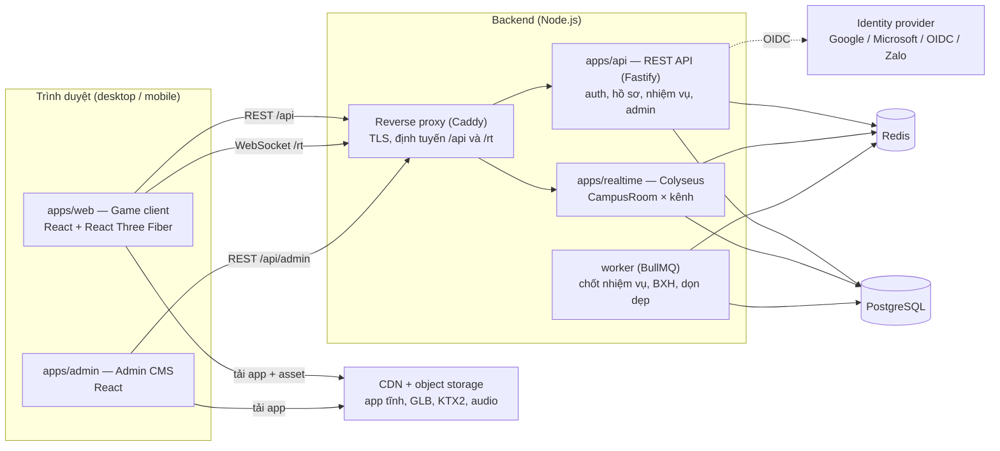

# 02 — Kiến trúc tổng thể

## 1. Sơ đồ hệ thống



Bốn điểm cần nắm:

1. **Client làm phần nặng về hình ảnh và di chuyển.** Server không chạy physics; nó giữ danh tính, vị trí đã kiểm tra, trạng thái nhiệm vụ và phát lại cho người khác.
2. **API và realtime là hai tiến trình riêng** dùng chung code nghiệp vụ (`packages/core`) và chung DB. Chúng nói chuyện với nhau qua Redis pub/sub, không gọi HTTP lẫn nhau. Deploy API không làm ai rớt mạng.
3. **Postgres là nguồn sự thật**; Redis chỉ giữ dữ liệu nóng, dựng lại được (presence, BXH, cache, hàng đợi).
4. **Địa lý của campus là dữ liệu** (`packages/map-data`), dùng chung cho client (dựng cảnh, minimap), server (kiểm tra vị trí) và admin (chọn điểm đặt nhiệm vụ).

## 2. Thành phần và trách nhiệm

| Thành phần | Trách nhiệm | Không làm |
|---|---|---|
| `apps/web` | Render 3D, điều khiển, camera, nội suy người chơi khác, HUD, tải asset | Không tự quyết tiến độ nhiệm vụ, không giữ bí mật (đáp án quiz) |
| `apps/admin` | Giao diện vận hành: nhiệm vụ, quiz, thông báo, người dùng, kiểm duyệt, số liệu | Không truy cập DB trực tiếp |
| `apps/api` | Xác thực, hồ sơ, đọc/ghi nhiệm vụ, BXH, cửa hàng, endpoint admin; chạy được ở vai trò `worker` | Không giữ kết nối realtime |
| `apps/realtime` | Phòng Colyseus: vào/ra, đồng bộ vị trí, chat, emote, ghế, tương tác, chạy mission runtime | Không có endpoint nghiệp vụ REST (chỉ health + thống kê kênh) |
| `packages/shared` | Kiểu dữ liệu, zod schema, hằng số, giao thức message, hợp đồng API — chạy được cả browser lẫn Node | Không phụ thuộc DOM hay Node API |
| `packages/map-data` | Định nghĩa bản đồ + hàm hình học (point-in-polygon, tìm khu vực, render SVG từng tầng) | Không chứa model 3D |
| `packages/core` | Nghiệp vụ: mission engine + objective handler, phần thưởng, BXH, kiểm duyệt | Không biết gì về HTTP hay Colyseus |
| `packages/db` | Schema Drizzle, migration, seed | — |

## 3. Tech stack

Phiên bản là ảnh chụp từ npm ngày 12/11/2026, sẽ chốt lại và ghim khi scaffold (P0).

### Client

| Mảng | Công nghệ | Phiên bản | Ghi chú |
|---|---|---|---|
| Ngôn ngữ | TypeScript | 7.0 | Nếu tooling nào chưa tương thích thì lùi về 6.x |
| Build | Vite | 8.x | Code-splitting theo route và theo module game |
| UI | React | 19.x | HUD, menu, admin |
| 3D | three.js | r187 (0.187) | `WebGLRenderer` (WebGL2) làm nền |
| 3D trong React | @react-three/fiber, @react-three/drei | 9.8, 10.7 | v10 (hỗ trợ WebGPU) còn alpha, chưa dùng |
| Va chạm | three-mesh-bvh | 0.9 | Capsule vs lưới tĩnh, raycast camera |
| State UI | zustand | 5.x | Chỉ cho dữ liệu tần suất thấp |
| Realtime | @colyseus/sdk | 0.18 | Bọc trong `net/` |
| REST | @tanstack/react-query + zod | 5.x, 4.x | Dùng chung schema với server |
| Style | Tailwind CSS | 4.x | HUD và admin |
| PWA | vite-plugin-pwa (Workbox) | — | Cache asset đã hash, cài lên màn hình chính (V1) |

### Server

| Mảng | Công nghệ | Phiên bản | Ghi chú |
|---|---|---|---|
| Runtime | Node.js | 24 LTS (tối thiểu 22) | Build bằng `tsc`, chạy JS đã biên dịch |
| Realtime | colyseus, @colyseus/schema | 0.18, 5.0 | + `@colyseus/redis-presence`, `@colyseus/redis-driver` khi scale; `@colyseus/monitor`, `@colyseus/loadtest`, `@colyseus/testing` |
| REST | Fastify | 5.x | + rate-limit, cookie, cors, type provider zod |
| ORM | Drizzle ORM | 0.45 | Migration bằng drizzle-kit |
| DB | PostgreSQL | 17+ | |
| Cache / hàng đợi | Redis 7+ hoặc Valkey; BullMQ | —, 6.x | |
| Xác thực | jose (JWT), openid-client (OIDC) | 6.x | Khoá bất đối xứng |
| Quan sát | pino, prom-client, Sentry | — | |

### Công cụ

| Mảng | Công nghệ |
|---|---|
| Monorepo | pnpm workspaces + Turborepo |
| Lint/format | Biome |
| Test | Vitest (unit/integration), Playwright (e2e), @colyseus/testing (phòng), @colyseus/loadtest (tải) |
| Asset | Blender → glTF/GLB; gltf-transform 4.x (Meshopt, KTX2/Basis), tuỳ chọn công cụ image-to-3D cho đạo cụ |
| CI/CD | GitHub Actions, Docker, GHCR |
| Về sau | recast-navigation (navmesh), LiveKit (voice), Rapier (chỉ trong minigame) |

## 4. Các quyết định kiến trúc (ADR tóm tắt)

| # | Quyết định | Phương án đã cân nhắc | Vì sao chọn |
|---|---|---|---|
| ADR-01 | **Web, Three.js + React Three Fiber** | Babylon.js; PlayCanvas; Unity WebGL / Godot Web | Gói tải nhỏ nhất, chạy tốt trong trình duyệt nhúng của app chat, dùng chung React cho HUD. Unity/Godot Web tải hàng chục MB và yếu trên mobile web. Babylon đầy đủ hơn nhưng nặng hơn và ít ăn khớp với React. PlayCanvas mạnh nhưng xoay quanh editor trên cloud, kém hợp với cách làm code-first |
| ADR-02 | **WebGL2 làm nền, chưa dùng WebGPU** | WebGPURenderer ngay từ đầu | Cần chạy trên Android cũ và webview. Hiệu ứng của dự án không cần WebGPU. Đánh giá lại sau khi R3F v10 ổn định |
| ADR-03 | **Colyseus 0.18 cho realtime** | Tự viết trên ws/Socket.IO; Cloudflare Durable Objects (PartyServer); Nakama; SpacetimeDB; Supabase Realtime/Liveblocks | Có sẵn đồng bộ state delta, matchmaking, reconnect, công cụ loadtest và monitor. Chạy trên Node thuần nên đặt được ở bất kỳ đâu, kể cả hạ tầng trong nước. Durable Objects co giãn tốt hơn khi viral nhưng phải tự viết đồng bộ và bị khoá vào một nhà cung cấp — để dành làm phương án B nếu định hướng thành sản phẩm công khai |
| ADR-04 | **Di chuyển do client quyết, server kiểm tra** (tốc độ, biên, tầng) | Server mô phỏng toàn bộ + client prediction | Đây là không gian giao lưu, không thi đấu. Bỏ physics phía server giúp một tiến trình chứa được nhiều người hơn hẳn |
| ADR-05 | **Tách `api` và `realtime`**, chung `packages/core` | Gộp REST vào tiến trình Colyseus; microservice nhỏ hơn nữa | Deploy/khởi động lại API không ngắt WebSocket. Phần REST dùng framework phổ biến, giới hạn phụ thuộc vào Colyseus trong một app |
| ADR-06 | **PostgreSQL + Drizzle, Redis** | MongoDB; Prisma; SQLite | Dữ liệu quan hệ rõ (người–nhiệm vụ–tiến độ–sổ điểm), cần transaction để trao thưởng đúng một lần. Drizzle nhẹ, gần SQL |
| ADR-07 | **Bản đồ là dữ liệu** dùng chung | Toạ độ nằm rải trong scene 3D | Server và admin cần cùng một nguồn toạ độ với client; greybox dựng tự động từ dữ liệu nên chơi được trước khi có art |
| ADR-08 | **Mission engine hướng dữ liệu + sự kiện, server quyết** | Viết code riêng cho từng nhiệm vụ; client tự báo hoàn thành | Admin tạo nhiệm vụ mỗi ngày không cần dev. Chống gian lận ở mức hợp lý |
| ADR-09 | **Avatar tự làm, dạng module, chung một bộ xương** | Ready Player Me; VRM/VRoid | Ready Player Me đã đóng dịch vụ công khai từ 31/01/2026. Tự chủ asset cho phép gộp mesh, chia sẻ animation, kiểm soát ngân sách |
| ADR-10 | **Va chạm bằng capsule + BVH**; navmesh thêm sau | Rapier/ecctrl ngay từ đầu; chỉ dùng navmesh | Thế giới tĩnh không cần physics engine (tiết kiệm ~1–2 MB WASM). Navmesh thêm ở V1 cho NPC, chạm-để-đi, dẫn đường. Rapier chỉ nạp trong minigame cần vật lý |
| ADR-11 | **Đồng bộ cả phòng, giới hạn ~100 người/kênh** | Area-of-interest từ đầu (StateView) | Ở mức 100 người, băng thông chấp nhận được (xem [05](05-multiplayer.md)) và patch dùng chung cho mọi client nên rẻ. Tài liệu Colyseus khuyên chưa dựa vào StateView cho tập lớn. Có sẵn lộ trình nâng cấp |
| ADR-12 | **JWT tự phát hành (khoá bất đối xứng) + nhà cung cấp danh tính cắm rời** | @colyseus/auth; dịch vụ auth thuê ngoài | Chưa biết công ty cho dùng IdP nào; cần hỗ trợ khách → tài khoản thật mà không mất tiến độ. Realtime chỉ giữ khoá công khai, không tự phát token được |
| ADR-13 | **Monorepo TypeScript**, hợp đồng bằng zod dùng chung | Nhiều repo; tRPC/GraphQL | Một ngôn ngữ từ client tới server, kiểu dữ liệu và giao thức định nghĩa một lần |
| ADR-14 | **Khởi đầu 1 VPS + Docker Compose + CDN** | Kubernetes; serverless | Đủ cho vài trăm người đồng thời, chi phí thấp, một người vận hành được. Lộ trình scale ở [09](09-infra-security.md) |

**Rủi ro lớn nhất của stack:** Colyseus chưa tới 1.0 và chủ yếu do một người duy trì. Giảm thiểu: ghim phiên bản; không dùng các gói còn beta (`@colyseus/database`, `@colyseus/auth`, `@colyseus/admin`); giao thức và logic game (kiểm tra di chuyển, chat, mission runtime) viết thành các "system" thuần TypeScript nhận sự kiện, không phụ thuộc API của framework; phía client mọi thứ đi qua lớp `net/`.

## 5. Cấu trúc monorepo

```
vngcampus_simulation/
├─ apps/
│  ├─ web/                 # game client
│  ├─ admin/               # admin CMS
│  ├─ api/                 # REST API + entrypoint worker
│  └─ realtime/            # Colyseus
├─ packages/
│  ├─ shared/              # types, zod schema, hằng số, giao thức, hợp đồng API (isomorphic)
│  ├─ map-data/            # bản đồ + hình học + render SVG (isomorphic)
│  ├─ core/                # nghiệp vụ (Node)
│  └─ db/                  # Drizzle schema, migration, seed (Node)
├─ tools/
│  ├─ asset-pipeline/      # tối ưu GLB, sinh manifest, kiểm tra ngân sách
│  ├─ map-tools/           # nhập OSM, xuất POI từ Blender, bake navmesh
│  └─ loadtest/            # bot giả lập người chơi
├─ assets-src/             # file nguồn Blender (Git LFS hoặc lưu ngoài repo)
├─ infra/                  # Dockerfile, compose, Caddyfile, script deploy
├─ docs/                   # bộ tài liệu này
└─ .github/workflows/
```

Quy tắc phụ thuộc: `apps/*` → `packages/*`; `core` → `db`, `shared`, `map-data`; `shared` và `map-data` không phụ thuộc gói nội bộ nào khác. `apps/web` và `apps/admin` không được import `core` hay `db`.

## 6. Quy ước xuyên suốt

| Chủ đề | Quy ước |
|---|---|
| Đơn vị | Mét, giây, radian. Trục Y hướng lên. 1 đơn vị three.js = 1 m |
| Vị trí trên đường truyền | Số nguyên cố định 1/32 m (int16 → ±1.023 m, sai số ~3 cm); góc quay 1 byte |
| Thời gian | DB và API dùng UTC ISO-8601. "Ngày nhiệm vụ" tính theo `Asia/Ho_Chi_Minh`. Logic game chỉ tin đồng hồ server |
| Định danh | UUIDv7 cho bản ghi DB. Khoá bản đồ dạng chuỗi có nghĩa: `area.atrium`, `poi.seat.koi_03` |
| Hợp đồng | Mọi input đi qua zod schema trong `packages/shared`. Server luôn validate; client validate ở chế độ dev |
| Lỗi | REST: `{ error: { code, message, details? } }` với `code` ổn định. Realtime: message `error { code, message }` |
| Cấu hình | Biến môi trường, validate bằng zod lúc khởi động; có `.env.example`; không commit bí mật |
| Log | pino JSON, kèm request id / session id. Không ghi email, nội dung chat, token |
| Ngôn ngữ | Chuỗi giao diện đi qua từ điển có kiểu, mặc định tiếng Việt. Nội dung do admin nhập lưu dạng `{ vi, en? }` |
| Cờ tính năng | Bảng `settings` + cache Redis, gửi cho client qua endpoint bootstrap |
| Code | TypeScript strict, Biome, không `any` trong hợp đồng dùng chung; test đặt cạnh code (`*.test.ts`) |
| Git | Nhánh ngắn, commit nhỏ theo conventional commits, CI phải xanh |

## 7. Chiến lược kiểm thử

| Tầng | Công cụ | Phủ cái gì |
|---|---|---|
| Unit | Vitest | Objective handler, hình học bản đồ, kiểm tra di chuyển, mã hoá/giải mã giao thức, tính streak/BXH |
| Integration | Vitest + Postgres/Redis thật (container) | API (auth, nhiệm vụ, admin), trao thưởng idempotent, migration |
| Phòng realtime | @colyseus/testing | Vào/ra, đồng bộ, chat, tương tác, luồng nhiệm vụ đầu-cuối không cần trình duyệt |
| E2E | Playwright | Hai trình duyệt vào cùng kênh và thấy nhau; hoàn thành một nhiệm vụ mẫu; đăng nhập |
| Hình ảnh | Playwright screenshot | Cảnh mốc không bị vỡ sau thay đổi asset |
| Tải | @colyseus/loadtest + bot | 100 bot/kênh, nhiều kênh; đo tick, CPU, băng thông |
| Ngân sách | Script CI | Kích thước bundle JS, kích thước từng asset, số tam giác/texture mỗi zone |

Ưu tiên: logic chạy trên server (nhiệm vụ, thưởng, kiểm tra) phải có test tự động; phần hình ảnh kiểm bằng ảnh chụp và thử tay trên thiết bị thật.

## 8. Tài liệu liên quan

- Luồng vào phòng và giao thức message: [05-multiplayer.md](05-multiplayer.md)
- Luồng xử lý tiến độ nhiệm vụ: [06-missions.md](06-missions.md)
- Schema DB, REST API, xác thực: [07-backend-data.md](07-backend-data.md)
- Triển khai và bảo mật: [09-infra-security.md](09-infra-security.md)
