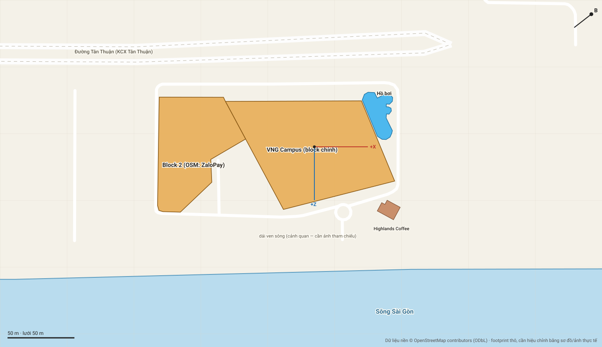

# 03 — Bản đồ, asset & avatar

## 1. Dữ liệu thật đã thu thập được

### 1.1 Thông tin công khai về VNG Campus

| Hạng mục | Thông tin | Nguồn |
|---|---|---|
| Địa chỉ | Z06, Đường số 13, P. Tân Thuận Đông, Quận 7, TP.HCM (KCX Tân Thuận) | vng.com.vn |
| Khánh thành | 2019 | CafeF, Người Quan Sát |
| Quy mô | 52.440 m² xây dựng và sử dụng; khu đất "hơn 4 ha" | vng.com.vn, CafeF, Hoa Học Trò |
| Hình khối | 2 block (15.829 m² và 14.971 m² sàn), thấp tầng; **3 tầng làm việc**; tầng lớn nhất hơn 13.000 m² | An Phát, Người Quan Sát |
| Trung tâm | **Atrium / giếng trời** — không gian sự kiện lớn ở giữa campus | Người Quan Sát, An Phát |
| Ngoài trời | **Hồ bơi** lọc muối + bể sục; cảnh quan cây xanh; view sông | Người Quan Sát, Hoa Học Trò |
| Ăn uống | Canteen ~800 chỗ với 2 khu Á – Âu; 12 coffee bar; **hồ cá Koi** cạnh quầy Phúc Long | An Phát, Hoa Học Trò, Người Quan Sát |
| Thể thao | Gym (kèm xông hơi), yoga, boxing | Người Quan Sát |
| Tiện ích khác | Phòng chiếu phim, cửa hàng tiện lợi, khu vui chơi trẻ em | vng.com.vn, CafeF |
| Phòng họp | Đặt tên theo thành phố: Bangkok, Bangalore, Jakarta, São Paulo… rải khắp khu làm việc | Người Quan Sát |
| Nội thất | Văn phòng mở, ít tường ngăn, **vách ngăn là kệ cây xanh**, màu tươi sáng, nhiều giếng trời lấy sáng | CafeF, An Phát |
| Cổng chính | "Cách điệu chữ V": mái che trắng trên các cột chữ V màu cam, ngay trước có đài phun nước; qua lễ tân là vào Atrium | Techsignin, SGGP, ảnh của VNG |
| Mặt đứng | Trắng, dải mái trên cùng gồm các tấm vát; ban công mỗi tầng trồng cây rủ; khối tây mặt kính tối; **chữ VNG màu cam** trên dải trên cùng của mặt đứng phía nam (nhìn ra sông) | Ảnh flycam của VNG |
| Atrium | Giếng trời dài trên mái; khán đài gỗ bậc thang hướng về màn LED trên vách ốp gỗ xương cá; hai bên là các tầng lửng lan can kính, cầu thang chéo lên tầng | Ảnh của VNG, Techsignin |
| Mái | Khối chính phủ pin mặt trời; ô giữa không có pin là giếng trời Atrium; khối tây mái bằng, góc tây bắc đặt máy lạnh | Ảnh vệ tinh |
| Khác | Chứng chỉ LEED Gold; hồ bơi có bể sục tròn ở đầu hồi, sàn gỗ quanh hồ | Tatinta, ảnh của VNG |

**Chưa có nguồn công khai:** mặt bằng từng tầng, vị trí chính xác của từng khu trong nhà (canteen, hồ Koi, gym), cầu thang/thang máy. Những phần này cần ảnh hoặc sơ đồ từ bạn (mục 8); trước lúc đó dùng vị trí giả định có gắn nhãn `placeholder`.

### 1.3 Đối chiếu với ảnh vệ tinh và ảnh chính thức (bản đồ 0.2, 18/11/2026)

Đã chiếu ảnh vệ tinh (Esri World Imagery, mức 19, khoảng 0,3 m/điểm ảnh) sang hệ toạ độ campus rồi vẽ chồng bản đồ lên, kèm ảnh trong bài viết chính thức của VNG và báo chí. Ảnh chỉ dùng để đối chiếu, **không lưu vào repo** (bản quyền của chủ ảnh); repo chỉ giữ toạ độ suy ra.

| Kết quả | Chi tiết |
|---|---|
| Khớp | Footprint OSM của hai khối và hồ bơi trùng mái nhìn từ trên xuống (sai lệch 1–2 m); đường nội bộ vòng quanh hai khối; vòng xoay phía sông; ki-ốt cà phê góc đông nam; giếng trời Atrium nằm đúng ô giữa mái (khoảng X −14…4, Z −10…12) |
| Đã sửa | **Cổng chính** ở mặt nam nhìn ra sông (trước cửa có mái che chữ V cam và đài phun nước giữa vòng xoay), không phải giữa mặt đường Tân Thuận — phía đường lớn chỉ có dải cây. **Sảnh lễ tân** ngay sau cửa chính, dẫn vào Atrium. **Bãi xe**: một hàng đỗ xe vuông góc dọc đường phía sông (X −74…6), không phải khu đất trống phía tây. **Hàng rào tây** theo hàng cây ở X ≈ −126; khu đất trống bên ngoài không thuộc campus. **Sân giữa hai khối** là sân vườn có bồn cây tròn (tâm X −52,5; Z 16) chứ không phải sân đón khách. Thêm biển chữ VNG trên mặt đứng nam |
| Vẫn giả định | Chốt bảo vệ (đặt ở lối xe góc đông bắc); vị trí các phòng trong nhà trừ Atrium và sảnh (đồ đạc bên trong đã dựng theo ảnh, xem §1.4) |

Nguồn: [bài "VNG Campus – mô hình văn phòng thông minh quốc tế" trên vng.com.vn](https://vng.com.vn/news/enterprise/vng-campus-3906.html), [Techsignin](https://www.techsignin.com/chinh-thuc-khai-truong-tru-so-vng-campus-tai-quan-7/), [SGGP](https://www.sggp.org.vn/vng-campus-mo-hinh-van-phong-thong-minh-quoc-te-post537236.html), [Tatinta](https://tatinta.com/diem-den/vng-campus-tru-so-chinh-vng/9159), ảnh vệ tinh Esri World Imagery (© Esri, Maxar và các nguồn khác).

### 1.4 Nội thất theo ảnh báo chí và ảnh của VNG (bản đồ 0.3, 18/11/2026)

Ảnh cho biết một khu trông thế nào (đồ đạc, vật liệu, cách xếp), không cho biết nó nằm đâu trong toà nhà. Nên bản 0.3 dựng **đồ đạc** theo ảnh, còn **vị trí phòng** (canteen, gym, phòng họp, pantry, yoga) vẫn giả định và giữ nhãn `placeholder`. Như §1.3, ảnh chỉ để đối chiếu, không lưu vào repo.

| Khu | Ảnh cho thấy | Đã dựng (0.3) |
|---|---|---|
| Atrium | Khán đài gỗ lớn từ sàn trệt lên hành lang tầng 2, lối bậc nhỏ chạy giữa, bean bag nhiều màu; màn LED trên khối ốp gỗ xương cá đối diện; hành lang kính tay vịn thép, thang bắc ngang; trần đen để lộ kỹ thuật | `connector.main.bleachers` loại `bleachers`: 16 bậc 0,31 m (bước lên được không cần nhảy), lối nửa bậc ở giữa, lan can kính hai bên; 16 bean bag là ghế ngồi được trên bậc; `led_wall`; sàn gỗ; lan can kính; mặt dưới sàn tối màu |
| Sảnh | Cổng soát vé (speed gate) ngay trước chân khán đài | 10 tủ cổng, làn rộng ~1 m; quầy lễ tân đặt lệch sang bên để lối từ cửa vào thông thoáng; sofa đỏ |
| Cà phê | The Coffee House "ngay sát trung tâm Campus", mặt ốp gỗ xương cá, băng ghế liền tường; tổng 12 điểm cà phê | Quầy bar ốp gỗ xương cá, kệ sau quầy, 6 ghế cao; tên chung "Quầy cà phê" |
| Canteen | Sảnh lớn, bàn gỗ dài xếp hàng, ghế xanh rêu, quầy phục vụ ốp gỗ xương cá dọc tường, khung lam gỗ treo đèn bóng tròn; 800 chỗ, 3 bếp Á–Âu | 28 bàn dài × 8 ghế (224 ghế ngồi được), 4 quầy dọc tường bắc, khung lam gỗ trên mỗi bàn, sàn gỗ |
| Gym (UPFIT) | Rack tạ trên sàn cao su, vách gương, máy chèo, máy chạy; phòng yoga "ở vị trí có view đẹp nhất" | 4 rack, 3 vách gương, 4 máy chèo, 2 giá tạ đơn, 8 máy chạy dọc cửa kính, sàn cao su; `area.yoga` ở đầu block 2 nhìn ra sông (tầng 3, giả định) |
| Văn phòng | Hầu như không vách ngăn; hàng bàn trắng, ghế lưới đen, hộp cây gỗ cuối hàng; booth hình ngôi nhà (đỏ, trắng, xám, đen) dọc hành lang; phòng họp vách kính sàn gỗ, màn hình, đặt chỗ online | Hàng bàn 2 cụm × 4 chỗ + hộp cây, chừa lối đi (Atrium → cửa sang block 2, chân và đầu cầu thang); 5 booth mỗi tầng ở hành lang đông Atrium; 4 phòng họp kính mỗi tầng dọc tường bắc, mỗi phòng 6 ghế |
| Pantry | Tường gạch, sofa và ghế bành đỏ, bàn cao ghế đôn cam | Mỗi tầng một pantry: quầy + tủ lạnh trên nền tường gạch, sofa đỏ, bàn cao 4 ghế |

Nguồn: [VietNamNet/ICTnews — Văn phòng hoành tráng xịn xò của công ty công nghệ Việt Nam](https://vietnamnet.vn/van-phong-hoanh-trang-xin-xo-cua-cong-ty-cong-nghe-viet-nam-cay-xanh-bao-la-quan-ca-phe-ho-boi-phong-gym-tha-ho-tu-tap-i38897.html), [CafeF — VNG Campus, từ trụ sở trong mơ…](https://cafef.vn/vng-campus-tu-tru-so-trong-mo-den-xu-the-kho-dao-nguoc-cua-moi-truong-sang-tao-mo-20191216110608607.chn), [Người Quan Sát — Cận cảnh VNG Campus](https://nguoiquansat.vn/can-canh-vng-campus-tru-so-hien-dai-bac-nhat-viet-nam-cua-ky-lan-cong-nghe-vng-vnz-156589.html), [vng.com.vn — Ngắm trụ sở công ty VNG vào mỗi dịp đặc biệt](https://vng.com.vn/news/enterprise/tru-so-cong-ty-vng.html).

Chưa dựng: hồ bơi có quán The Mojo, cửa hàng tiện lợi, khu giữ trẻ, máy bán hàng tự động, tủ đặt chỗ phòng họp, tường chữ "Embracing Challenges".

### 1.2 Sơ đồ nền từ OpenStreetMap



OpenStreetMap đã có footprint của campus. Dữ liệu đã trích lưu ở [`reference/osm-campus.geojson`](reference/osm-campus.geojson) (kèm toạ độ đã đổi sang hệ campus).

| Đối tượng | OSM way | Kích thước thô | Vị trí trong hệ campus (m) |
|---|---|---|---|
| Block chính "VNG Campus" | 1176528258 | footprint ~6.900 m² (chỉ 6 đỉnh) | X −66…60, Z −34…47 |
| Block 2 (OSM ghi "ZaloPay") | 1234832061 | ~3.900 m² | X −117…−51, Z −37…49 |
| Hồ bơi | 1193265278 | ~500 m², khoảng 37 × 27 m | X 36…58, Z −41…−5 |
| Highlands Coffee | 1193135788 | ~140 m² | X 47…64, Z 40…55 |
| Đường Tân Thuận | 253275100, 1576453086 | 2 chiều tách riêng | Z ≈ −64…−77 |
| Bờ sông Sài Gòn | (quan hệ 3850169) | — | Z ≈ +92…+99 |
| Đường nội bộ | 899720023 và các way lân cận | vòng quanh hai block | — |

Nhận xét: campus nằm trên một dải đất rộng khoảng 160 m giữa đường Tân Thuận và sông Sài Gòn, hai block xếp dọc theo đường. Tổng footprint OSM ~10.900 m² (nhỏ hơn con số "tầng lớn nhất hơn 13.000 m²" — có thể con số đó tính cả hành lang ngoài, ban công); đối chiếu ảnh vệ tinh cho thấy đường viền OSM khớp mái thật (xem §1.3).

## 2. Hệ toạ độ và tỉ lệ

- 1 đơn vị = 1 m. Trục Y hướng lên.
- **Gốc toạ độ:** tâm block chính theo OSM — vĩ độ 10.7585017, kinh độ 106.7459539, cao độ mặt đất = 0.
- **Trục xoay theo campus**, không theo hướng bắc: `+X` chạy dọc đường Tân Thuận về phía đông bắc (phương vị 38°), `+Z` hướng ra sông (phương vị 128°). Nhờ vậy tường nhà gần như thẳng theo trục, dễ dựng và dễ đặt toạ độ.
- Nhìn từ trên xuống trong three.js: X sang phải, Z xuống dưới — trùng với sơ đồ ở trên.
- Hướng bắc thật lưu trong metadata để đặt hướng nắng và la bàn.
- **Biên thế giới MVP:** X −200…150, Z −90…110 (khoảng 350 × 200 m). Hàng rào campus: phía đường ở Z −57, phía tây ở X −126 (bản đồ 0.2), phía đông X 90, phía sông cách bờ 4 m.
- **Cao độ tầng (giả định, chờ xác minh):** F1 = 0 m (cao 5,0 m), F2 = 5,0 m, F3 = 9,5 m, mái = 14,0 m.

## 3. Phân khu

Mã khu (`area.*`) là khoá ổn định; nhiệm vụ và server tham chiếu tới chúng. Bảng dưới là **bản đồ v0** đang có trong `packages/map-data/src/campus.json`. Footprint hai block, hồ bơi, đường nội bộ và bờ sông lấy từ OpenStreetMap; những gì gắn nhãn `placeholder` là vị trí giả định, sẽ chỉnh ở P6.2.

| Nhóm | Khu | Tầng | Nguồn | Ghi chú |
|---|---|---|---|---|
| Ngoài trời | `area.site` khuôn viên (bên trong hàng rào) | F1 | Suy ra từ đường và bờ sông | Vùng đi được ngoài trời; ra ngoài là hết bản đồ |
| | `area.gate_main` cổng chính | F1 | Ảnh + vệ tinh (0.2) | Sân trước cửa chính ở mặt nam, dưới mái che chữ V cam, nhìn ra đài phun nước. Điểm xuất hiện đầu ngày |
| | `area.fountain` đài phun nước | F1 | Vệ tinh (0.2) | Giữa vòng xoay trước cổng; mặt nước, không đi vào được |
| | `area.parking` bãi xe | F1 | Vệ tinh (0.2) | Hàng đỗ xe vuông góc dọc đường phía sông |
| | `area.forecourt` sân vườn | F1 | OSM + vệ tinh (0.2) | Khoảng lõm giữa hai block; có `area.garden_planter` bồn cây tròn ở giữa (tên cũ "sân đón khách") |
| | `area.pool` hồ bơi · `area.pool_deck` khu hồ bơi | F1 | OSM | Hồ là mặt nước, không đi vào được |
| | `area.riverside` công viên ven sông | F1 | Suy ra | Lối dạo, ghế, điểm chụp ảnh |
| | `area.cafe_terrace` sân cà phê ngoài trời | F1 | OSM (ki-ốt cà phê) | Dùng tên chung, chưa dùng tên thương hiệu |
| | `area.river` sông Sài Gòn | F1 | OSM | Phông nền, không đi vào được |
| Tầng trệt | `area.main.f1`, `area.block2.f1` | F1 | OSM | Toàn bộ mặt sàn của mỗi block |
| | `area.lobby` sảnh lễ tân | F1 | Suy ra từ bài viết (0.2) | Ngay sau cửa chính phía nam, dẫn vào Atrium; kích thước vẫn giả định |
| | `area.atrium` Atrium · `area.atrium_bleachers` khán đài | F1 (thông tầng) | Vệ tinh + ảnh (0.3) | Giữa block chính, 36 × 28 m. Khán đài gỗ phía bắc lên thẳng hành lang tầng 2, màn LED phía nam; thêm một cầu thang lớn phía đông |
| | `area.canteen` canteen | F1 | Vị trí giả định, đồ đạc theo ảnh (0.3) | Góc đông bắc, cạnh hồ bơi; bàn dài, quầy dọc tường bắc |
| | `area.koi` khu hồ Koi · `area.koi_pond` · `area.coffee_main` | F1 | Giả định | Phía nam Atrium; chỉ 8 ghế quanh hồ; quầy cà phê ốp gỗ (0.3) |
| | `area.gym` phòng gym | F1 | Vị trí giả định, đồ đạc theo ảnh (0.3) | Trong block 2; sàn cao su |
| Tầng trên | `area.office.f2.main`, `area.office.f2.block2`, `area.office.f3.*` | F2, F3 | OSM | Văn phòng mở quanh khoảng thông tầng; booth dọc hành lang đông Atrium |
| | `area.meeting.f2_01…04`, `area.meeting.f3_01…04` phòng họp | F2, F3 | Giả định (0.3) | Phòng kính dọc tường bắc block chính, đặt tên "Phòng họp 2.01"… vì chưa biết tên thật |
| | `area.pantry.f2`, `area.pantry.f3` | F2, F3 | Giả định (0.3) | Góc đông block chính |
| | `area.yoga` phòng yoga | F3 | Giả định (0.3) | Đầu block 2 phía sông |

Khu nhỏ trong nhà mang nhãn `room` (phòng họp, pantry, yoga): bộ sinh không đặt bàn làm việc vào đó. Nhãn `timber` và `rubber` chọn màu sàn (gỗ, cao su).

Chưa có trong bản đồ (thêm khi có tư liệu): cửa hàng tiện lợi, phòng chiếu phim, khu vui chơi trẻ em, tên thật của các phòng họp.

Xem bản đồ từng tầng, kèm toạ độ dưới con trỏ: chạy `pnpm dev` rồi mở `http://localhost:5173/debug/map`.

## 4. Định dạng map-data

Một tài liệu JSON có phiên bản, là nguồn duy nhất về địa lý. Kiểu và zod schema nằm ở `packages/map-data/src/schema.ts`; phần dưới là bản rút gọn.

```ts
type Vec2 = [x: number, z: number];            // mét, hệ toạ độ campus
type FloorId = 'F1' | 'F2' | 'F3' | 'ROOF';
type LocalizedText = { vi: string; en?: string };

interface CampusMap {
  version: string;                 // semver; đổi/xoá id của area hoặc POI = tăng major
  meta: {
    origin: { lat: number; lon: number };
    xAxisBearingDeg: number;       // 38
    bounds: { min: Vec2; max: Vec2 };
  };
  floors: Array<{ id: FloorId; y: number; height: number; label: LocalizedText }>;
  areas: Area[];                   // khu vực có tên
  structures: Structure[];         // khối nhà
  paths: Path[];                   // đường, lối đi
  connectors: Connector[];         // cầu thang, dốc
  pois: Poi[];                     // điểm có ý nghĩa
  spawnSets: Record<string, string[]>;   // tên bộ → danh sách POI (điểm xuất hiện, điểm rải vật phẩm, lộ trình)
  props: PropGroup[];              // cây, đèn, xe, cụm bàn… (instancing)
}

interface Area {
  id: string;                      // 'area.atrium'
  name: LocalizedText;
  floor: FloorId;
  polygon: Vec2[];
  kind: 'outdoor' | 'indoor' | 'water' | 'restricted';
  walkable: boolean;
  tags: string[];                  // 'base' | 'landmark' | 'event' | 'green' | 'placeholder'
}

interface Structure {
  id: string;                      // 'structure.main'
  name: LocalizedText;
  footprint: Vec2[];
  floors: FloorId[];               // các tầng có sàn, từ thấp lên; mái nằm trên tầng cuối
  voids: Array<{ id: string; polygon: Vec2[]; floors: FloorId[] }>;      // lỗ trên sàn (Atrium); có 'ROOF' = giếng trời
  openings: Array<{ id: string; floor: FloorId; at: Vec2; width: number }>;  // cửa: `at` nằm trên một cạnh footprint
  height?: number;                 // nhà một tầng thấp hơn chiều cao tầng chuẩn
  style: string;                   // khoá style khi dựng greybox
  model?: string;                  // khoá GLB thay thế khi đã có art
}

interface Path { id: string; kind: 'road' | 'walkway' | 'track'; floor: FloorId; points: Vec2[]; width: number; closed: boolean }

interface Connector {              // một vế thang thẳng từ lower.at lên upper.at
  id: string;
  kind: 'stairs' | 'ramp' | 'bleachers'; // bleachers: bậc ngồi được, mỗi bậc ≤ 0,32 m, lối nửa bậc ở giữa
  structure: string;
  lower: { floor: FloorId; at: Vec2 };
  upper: { floor: FloorId; at: Vec2 };
  width: number;                   // bộ dựng tự khoét dải này khỏi sàn tầng trên để có khoảng thông đầu
}

interface Poi {
  id: string;                      // 'poi.seat.koi_03'
  kind: 'spawn' | 'checkpoint' | 'seat' | 'npc_spot' | 'kiosk_spot' | 'photo_spot' | 'item_spot';
  name?: LocalizedText;
  floor: FloorId;
  position: Vec2;
  y?: number;                      // mặc định = cao độ tầng; ghế trên khán đài ghi độ cao bậc
  yawDeg?: number;                 // 0° nhìn về +Z (sông), 90° nhìn về +X
  radius?: number;
  meta?: Record<string, unknown>;  // ghế: { furniture: 'bench' | 'chair' | 'stool' | 'lounger' | 'sofa' | 'beanbag' | 'built_in' }
                                   // built_in: ghế là một phần của đạo cụ khác (bàn canteen, booth, phòng họp)
}

interface PropGroup {
  model: string;                   // 'tree_a', 'lamp', 'desk_cluster', 'canteen_table', 'meeting_room'…
  instances: Array<{ p: Vec2; floor: FloorId; yawDeg?: number; s?: number }>;
}
```

**Hai lối vào của gói:**

| Import | Có gì |
|---|---|
| `@campus/map-data` | Thư viện dùng cho mọi bản đồ: kiểu, schema, hình học (`pointInPolygon`, `nearestEdge`, `stripPolygon`…), truy vấn (`createMapIndex`, `floorAt`, `findArea`, `areasAt`, `isWalkable`, `nearestPoi`, `poisOfSet`), và `renderFloorSvg()` / `createFloorProjection()` |
| `@campus/map-data/campus` | Dữ liệu campus: `campusMap` và `campusIndex` |

`isWalkable(point, floor)` trả lời câu hỏi "ở đây có sàn để đứng không" — dùng khi đặt vật phẩm, ghế, điểm nhiệm vụ. Nó không biết tới tường (tường không nằm trong dữ liệu bản đồ).

**Cách sinh bản đồ v0:** `pnpm map:build` chạy `tools/map-tools`, đọc `docs/reference/osm-campus.geojson`, ghép với bố cục giả định viết trong `campus-v0.ts`, kiểm tra từng điểm đặt có nằm trên sàn không, rồi ghi `campus.json`. Không sửa tay `campus.json`: có test so file đã commit với kết quả của bộ sinh. Từ P6.2, khi hiệu chỉnh theo tư liệu thật, cách soạn bản đồ sẽ được xem lại.

**Ai dùng map-data:**

| Nơi dùng | Dùng để |
|---|---|
| Client | Dựng greybox, sinh lưới va chạm, minimap, đặt bảng tên khu, điểm xuất hiện |
| Realtime | Kiểm tra biên và tầng khi di chuyển, phát hiện vào/ra khu vực, kiểm tra khoảng cách khi tương tác, cấp ghế |
| Mission engine | Giải nghĩa tham chiếu `areaId`, `poiId`, `spawnSet` trong định nghĩa nhiệm vụ |
| Admin | Vẽ bản đồ 2D từng tầng để chọn vị trí; kiểm tra điểm đặt có nằm trong vùng đi được |

## 5. Pipeline dựng thế giới

Nguyên tắc: **luôn có một campus chơi được**. Art thay dần greybox theo từng khu, không chặn phần gameplay.

| Giai đoạn | Việc làm | Kết quả |
|---|---|---|
| A. Sơ đồ nền v0 | Nhập footprint OSM, thêm khu vực và POI giả định theo thông tin công khai | `campus.json` v0, mọi vị trí chưa chắc gắn `placeholder` |
| B. Greybox thủ tục | Code dựng cảnh từ map-data: nền đất tô màu theo khu, đường, khối nhà đùn từ footprint có sàn từng tầng và khoảng thông tầng, cầu thang dạng dốc, mặt nước, cây/ghế/đèn bằng instancing, bảng tên khu | Campus đi lại được, có va chạm, nhìn sạch sẽ dù chưa có art |
| C. Hiệu chỉnh | Đặt ảnh sơ đồ/ảnh vệ tinh bạn gửi làm lớp nền trong công cụ dev, sửa footprint, đặt đúng các khu trong nhà và POI | `campus.json` v1 khớp thực tế |
| D. Art theo khu | Dựng trong Blender bằng bộ module (tường, mặt kính, cột, cầu thang, bàn ghế, kệ cây) + các điểm nhấn (giếng trời Atrium, hồ bơi, hồ Koi, quầy lễ tân). Bake ánh sáng. Xuất GLB | Từng zone GLB thay cho greybox tương ứng |
| E. Hoàn thiện | Biển hiệu, decal, nước, cá Koi, âm thanh môi trường, NPC | Campus "có hồn" |

### 5.0 Bộ dựng greybox (giai đoạn B, đã có)

Nằm ở `apps/web/src/game/world`. `buildWorld(map)` là three.js thuần, không đụng DOM, nên chạy được cả trong test.

| Thành phần | Cách làm |
|---|---|
| Gộp lưới | `MeshBatch` gộp mọi hình đơn giản thành một lưới tô màu theo đỉnh cho mỗi **tầng hiển thị**: `ground` (ngoài trời), `F1`, `F2`, `F3`, `ROOF`. Mỗi tầng có một lưới đặc và một lưới kính |
| Lớp phẳng trên mặt đất | Cỏ, lát nền, đường, lối đi, sàn trong nhà, phòng, mặt nước gần như đồng phẳng nên mỗi lớp là một lưới riêng vẽ với polygon offset. Chỉ chênh cao độ thì nhìn từ xa sẽ nhấp nháy |
| Nhà | Mỗi tầng: tường có chân tường đặc, băng kính, dầm trên; cửa khoét theo `openings`. Sàn tầng trên khoét `voids` và giếng thang. Mái có giếng trời lợp kính. Tường chung giữa hai block chỉ dựng một lần |
| Cầu thang | Vẽ thành bậc, nhưng va chạm là một mặt dốc nhẵn. Lan can kính tay vịn thép hai bên và quanh mọi lỗ sàn, chừa trống đúng chỗ thang đáp |
| Khán đài | Loại `bleachers`: va chạm chính là các bậc (0,31 m, thấp hơn bước 0,35 m của nhân vật), nên đi bộ lên được và ghế đặt đúng mặt bậc. Mép trên mở thẳng ra hành lang tầng 2 |
| Đạo cụ | `InstancedMesh` cho model lặp nhiều (cây, đèn, xe, cụm bàn, hộp cây, kệ cây) và cho đồ nội thất của từng ghế. Đồ cố định ít bản sao (`bake: true`: màn LED, cổng soát vé, quầy, bàn canteen, máy tập, booth, phòng họp…) được gộp thẳng vào lưới của tầng, phần kính vào lưới kính, nên không tốn thêm draw call. Va chạm có thể gồm nhiều hộp (booth, phòng họp có cửa) |
| Va chạm | Một lưới riêng, không vẽ: mặt đất, tường, sàn, dốc, lan can, đạo cụ đặc, cộng rào vô hình kín quanh khuôn viên và quanh mặt nước. Có BVH (three-mesh-bvh) |
| Bảng tên khu | Sprite vẽ bằng canvas 2D (đúng dấu tiếng Việt), chỉ cho khu gắn nhãn `landmark` |
| Cắt lớp | `world.showUpTo(tầng)` ẩn các tầng phía trên để nhìn vào trong nhà |

Test (`buildWorld.test.ts`) bắn tia vào lưới va chạm: sàn đúng cao độ ở từng tầng, Atrium thông từ đất tới giếng trời, thang dốc đều, khán đài lên được bằng chính `CharacterMotor`, đi lọt qua cửa, làn cổng soát vé và cửa phòng họp nhưng không lọt qua tường hay vách kính, và **dưới mọi POI đều có sàn** (hoặc mặt bậc khán đài).

### 5.1 Quy ước Blender

- 1 đơn vị = 1 m; gốc file trùng gốc campus; mỗi zone một file `.blend`.
- Collection: `VIS` (mesh hiển thị), `COL` (khối va chạm đơn giản: hộp, dốc), `POI` (empty đặt tên theo id POI — có script xuất ngược về map-data), `LOD1`.
- Vật lặp lại đặt tên `inst.<model>.<số>` để pipeline chuyển thành instancing.
- Mỗi zone tối đa ~8 material, dùng chung atlas/bảng màu; texture không quá 2K.

### 5.2 Pipeline asset (`tools/asset-pipeline`)

```
assets-src/*.blend
  → xuất GLB thô (Blender CLI)
  → gltf-transform: dedup → prune → weld → simplify (LOD) → instance → resample → quantize → meshopt
  → texture: resize (≤ 1024, điểm nhấn ≤ 2048) → KTX2 (ETC1S cho màu, UASTC cho normal)
  → dist/assets/<tên>.<hash>.glb + manifest.json (zone → url, dung lượng, bounding box, phụ thuộc)
  → kiểm tra ngân sách: vượt là CI báo lỗi
```

### 5.3 Dùng AI hỗ trợ tạo asset

- **Hợp:** đạo cụ rời — chậu cây, bàn ghế, máy bán nước, tượng, linh vật. Dùng công cụ image-to-3D (Meshy, Tripo, Hunyuan3D…) từ ảnh chụp, rồi dọn lại trong Blender (tỉ lệ, tâm xoay, giảm lưới, gộp material) trước khi vào pipeline.
- **Không hợp:** kiến trúc. Khối nhà vuông vức dựng tay hoặc sinh thủ tục cho lưới sạch và nhẹ hơn nhiều.
- **Văn phòng mở:** không dựng tay từng bàn. Viết bộ sinh theo quy tắc rải cụm bàn ghế và kệ cây vào đa giác khu làm việc bằng instancing.

### 5.4 Tải thế giới theo khu (streaming)

- Manifest liệt kê các zone kèm bounding box và mức ưu tiên.
- Luôn tải: `exterior` (ngoại cảnh + vỏ nhà). Các zone trong nhà tải khi người chơi tới gần (< 60 m) hoặc cùng tầng; gỡ khi đi xa (> 120 m) và bộ nhớ căng.
- Greybox của một zone hiển thị cho tới khi GLB của nó tải xong, sau đó mờ dần sang bản đẹp. Mạng chậm vẫn đi lại được.
- Chỉ render tầng đang đứng và phần nhìn thấy qua khoảng thông tầng; tầng khác ẩn.

## 6. Ngân sách asset và hiệu năng

| Hạng mục | Ngân sách |
|---|---|
| Tải tới lúc đi được (lần đầu, đã nén) | ≤ 6 MB: JS ≤ 600 KB, ngoại cảnh ≤ 3 MB, avatar + animation lõi ≤ 1,5 MB, UI + font ≤ 300 KB |
| Toàn bộ campus (tải dần) | ≤ 40 MB |
| Mobile, trên màn hình | ≤ 120 draw call, ≤ 250.000 tam giác, bộ nhớ texture ≤ 128 MB |
| Desktop, trên màn hình | ≤ 300 draw call, ≤ 1.000.000 tam giác |
| Avatar | LOD0 ≤ 5.000 tam giác, 1 draw call, ≤ 40 xương, không texture riêng (dùng màu đỉnh) |
| Bộ animation lõi | ≤ 500 KB |

## 7. Hệ avatar

**Phong cách:** low-poly, tỉ lệ hơi "chibi" (đầu nhỉnh hơn) — thân thiện, che được độ chi tiết thấp, rẻ để render.

**Cấu trúc module, chung một bộ xương:**

| Phần | Lựa chọn |
|---|---|
| Thân | 2–3 dáng, tông da từ bảng màu |
| Tóc | Nhiều kiểu + màu |
| Áo, quần/váy, giày | Kiểu + màu từ bảng màu |
| Phụ kiện | Kính, mũ, **dây đeo + thẻ nhân viên** (dấu ấn riêng của game) |

- Khi một avatar xuất hiện, các phần được **gộp thành một skinned mesh duy nhất**, tô bằng màu đỉnh → 1 draw call mỗi người. Những người trông giống hệt nhau dùng chung một geometry.
- Cấu hình avatar là một chuỗi ngắn (≤ 32 byte), mỗi lựa chọn một chữ số hệ 36, ví dụ `v1.b1.s2.h3-5.t1-c.p0-4.f0-1.a2` (dáng, da, tóc-màu, áo-màu, quần/váy-màu, giày-màu, phụ kiện); lưu ở `users.avatar`, đi trong access token và state của phòng. Mã hoá/giải mã ở `packages/shared/src/avatar.ts`. Người chưa chọn (chuỗi rỗng) có avatar sinh ổn định từ user id — ai nhìn cũng thấy giống nhau.
- **Animation dùng chung:** đứng, đi, chạy, nhảy, ngồi (xuống/giữ/đứng dậy), vẫy tay, vỗ tay, cúi chào, 2 điệu nhảy, reo mừng. V1 thêm bơi, bê đồ, và pha trộn nửa thân trên (vẫy tay khi đang đi).

**Mức chi tiết theo khoảng cách và trần số lượng:**

| Mức | Khoảng cách | Mô tả | Low | Medium | High |
|---|---|---|---|---|---|
| LOD0 | ≤ 12 m | Đầy đủ, animation mỗi frame | 12 | 25 | 50 |
| LOD1 | 12–35 m | ~1.200 tam giác, animation 15 Hz | 20 | 40 | 80 |
| LOD2 | > 35 m hoặc vượt trần | Hình nộm phẳng (impostor) + thẻ tên | còn lại | còn lại | còn lại |

**Thẻ tên:** vẽ bằng Canvas 2D (hiển thị tiếng Việt có dấu chuẩn theo font trình duyệt) vào một atlas texture, render dạng sprite; mờ dần theo khoảng cách.

**Hiện tại (P3.3):** nhân vật khối low-poly dựng bằng code (`apps/web/src/game/avatars/Avatar.ts`), lắp từ các phần theo cấu hình: 3 dáng người, 8 tông da, 9 kiểu tóc × 10 màu, 4 kiểu áo (áo thun, sơ mi, hoodie, áo khoác), quần dài/short/váy, 3 kiểu giày, 16 màu vải, 5 phụ kiện (kính, kính râm, mũ lưỡi trai, mũ len, tai nghe); luôn có dây đeo + thẻ nhân viên. 12 xương, skin cứng, animation thủ tục (đứng, đi/chạy liền mạch theo tốc độ, nhảy, rơi, ngồi, nhún khi tiếp đất, 6 emote). Tổ hợp nặng nhất là 504 tam giác (test kiểm tra ngân sách cho từng lựa chọn), nên LOD1 dùng chính mesh đó, chỉ hạ animation xuống 15 Hz; LOD2 là hình nộm instanced, màu áo theo cấu hình. Không cần tải asset nào. Trình chỉnh avatar (nút "Avatar") có xem trước 3D xoay tròn, nút ngẫu nhiên; lưu là mọi người trong kênh thấy ngay.

**Bộ CC0 của Quaternius** (*Universal Base Characters*, *Universal Animation Library*) vẫn là lựa chọn khi làm phần mỹ thuật ở P6: thay hàm dựng hình bằng các phần glTF cùng bộ xương, giữ nguyên chuỗi cấu hình và cách đồng bộ. Không dùng dịch vụ avatar bên thứ ba (Ready Player Me đã đóng dịch vụ công khai từ 31/01/2026).

## 8. Tư liệu cần bạn cung cấp

Càng nhiều càng tốt, nhưng **A và B là đủ để bắt đầu hiệu chỉnh**. Danh sách chụp chi tiết theo từng khu, kèm bản đồ điểm đứng, ở [12-photo-survey.md](12-photo-survey.md).

| Nhóm | Cần gì | Ghi chú |
|---|---|---|
| **A. Mặt bằng** | Sơ đồ tổng thể khu đất; sơ đồ từng tầng. Sơ đồ thoát hiểm dán ở hành lang là nguồn rất tốt | Ảnh chụp thẳng, rõ chữ |
| **B. Ngoại thất** | 4 mặt đứng của mỗi block, cổng + chốt bảo vệ, bãi xe, đường nội bộ, hồ bơi, dải ven sông, biển hiệu | Chụp ngang, có người hoặc xe làm thước đo |
| **C. Nội thất** | Sảnh lễ tân, Atrium (từ dưới lên và từ tầng trên nhìn xuống), canteen, hồ Koi + quầy cà phê, gym, một khu làm việc điển hình, hành lang, cầu thang/thang máy, cửa phòng họp có bảng tên | Tránh chụp rõ mặt người và màn hình máy tính |
| **D. Video** | 1–2 phút đi bộ dọc các tuyến chính | Giúp ước lượng khoảng cách và trình tự không gian |
| **E. Danh mục** | Tên các khu, tên phòng họp, màu nhận diện, tượng/linh vật/góc trang trí đáng nhớ | |
| **F. Vùng cấm** | Những khu không được dựng | Xem mục an ninh ở [09](09-infra-security.md) |

Lưu ý: nếu repo để công khai thì **không commit ảnh và sơ đồ nội bộ** vào repo; để ở kho riêng tư.

## 9. Bản quyền và ghi công

| Nguồn | Giấy phép | Việc cần làm |
|---|---|---|
| OpenStreetMap | ODbL 1.0 | Ghi "© OpenStreetMap contributors" trong màn hình giới thiệu; giữ file dữ liệu trích trong repo |
| Bộ asset Quaternius | CC0 | Không bắt buộc ghi công, vẫn nên ghi |
| Asset tự làm / AI tạo | — | Kiểm tra điều khoản của công cụ AI trước khi dùng cho mục đích chính thức |
| Logo VNG | Nhãn hiệu của VNG | **Dùng từ 18/11/2026 theo yêu cầu của chủ dự án**: chỉ file gốc từ [thư viện của VNG](https://vng.com.vn/gallery/logo.1.html), không sửa, đúng tổ hợp màu và khoảng trống trong [hướng dẫn thương hiệu](https://vng.com.vn/guidelines/brand/logo.html) (xem `apps/web/src/assets/brand/README.md`) |
| Thương hiệu đối tác (Phúc Long, Highlands…) | Thuộc chủ sở hữu | Cần được cho phép; khi chưa có thì dùng tên chung chung ("Quầy cà phê") |
| Ảnh vệ tinh, ảnh báo chí và ảnh của VNG dùng để đối chiếu | Thuộc chủ ảnh | Chỉ dùng làm tham chiếu, không đưa vào repo; ghi nguồn ở §1.3 và §1.4 |

## 10. Nguồn tham khảo

- [vng.com.vn — Trụ sở công ty VNG ở đâu](https://vng.com.vn/news/enterprise2/cong-ty-vng-o-dau.html)
- [vng.com.vn — Ngắm trụ sở công ty VNG vào mỗi dịp đặc biệt](https://vng.com.vn/news/enterprise/tru-so-cong-ty-vng.html)
- [VietNamNet/ICTnews — Văn phòng hoành tráng xịn xò của công ty công nghệ Việt Nam](https://vietnamnet.vn/van-phong-hoanh-trang-xin-xo-cua-cong-ty-cong-nghe-viet-nam-cay-xanh-bao-la-quan-ca-phe-ho-boi-phong-gym-tha-ho-tu-tap-i38897.html)
- [CafeF — VNG Campus, từ trụ sở trong mơ…](https://cafef.vn/vng-campus-tu-tru-so-trong-mo-den-xu-the-kho-dao-nguoc-cua-moi-truong-sang-tao-mo-20191216110608607.chn)
- [Người Quan Sát — Cận cảnh VNG Campus](https://nguoiquansat.vn/can-canh-vng-campus-tru-so-hien-dai-bac-nhat-viet-nam-cua-ky-lan-cong-nghe-vng-vnz-156589.html)
- [Hoa Học Trò — Khám phá từng ngóc ngách trụ sở VNG](https://hoahoctro.tienphong.vn/tphcm-kham-pha-tung-ngoc-ngach-trong-tru-so-sieu-to-khong-lo-cua-cong-ty-vng-post1215314.tpo)
- [An Phát — Công trình VNG Campus](https://anphat.com/vi/cong-trinh-toa-nha-van-phong-vng-quan-7.html)
- [OpenStreetMap — way 1176528258](https://www.openstreetmap.org/way/1176528258)
- [Quaternius — Universal Base Characters](https://quaternius.com/packs/universalbasecharacters.html), [Universal Animation Library](https://quaternius.com/packs/universalanimationlibrary.html)
