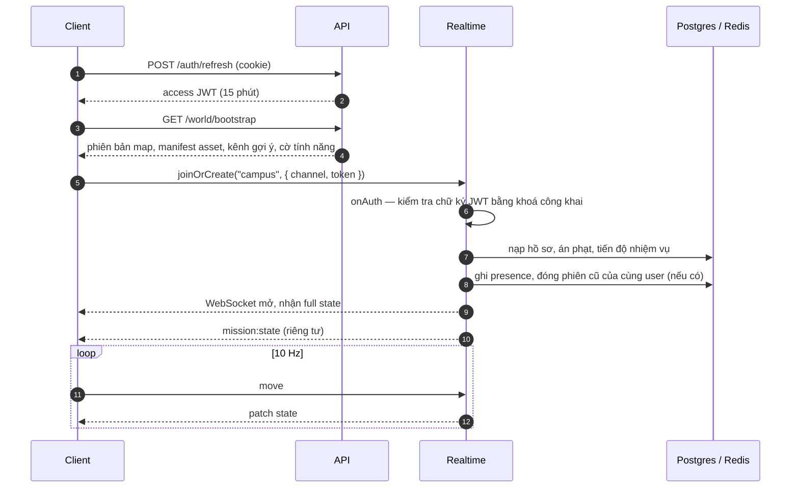

# 05 — Multiplayer

## 1. Mô hình: kênh và phòng

- **Một kênh = một phòng `CampusRoom`** chứa toàn bộ campus. Mọi người trong cùng kênh thấy nhau, không có màn hình chờ khi đi giữa các khu.
- **Sức chứa mỗi kênh:** ngưỡng mềm 80, ngưỡng cứng 100.
  - Tự xếp kênh: đưa người mới vào kênh **đông nhất còn dưới ngưỡng mềm** để thế giới luôn có cảm giác đông.
    Cách làm (P2.1): phòng ghi metadata `{ channel, open }`, `open = số người < ngưỡng mềm`. Client tự xếp kênh gọi `joinOrCreate('campus', { open: true })`; phòng được đăng ký với `filterBy(['open']).sortBy({ clients: -1 })` nên Colyseus chọn phòng mở đông nhất, hết phòng mở thì tạo phòng mới. `maxClients` = ngưỡng cứng. Vào kênh của đồng nghiệp dùng `joinById` (được tới ngưỡng cứng). Danh sách kênh: `GET /rt/channels`.
  - Mọi kênh đều chạm ngưỡng mềm → mở kênh mới ("Campus 2", "Campus 3"…).
  - Chủ động chuyển sang kênh của đồng nghiệp: được phép cho tới ngưỡng cứng.
  - Kênh trống tự đóng.
- Vì sao không chia phòng theo khu (sảnh, canteen…): khi tổng số người online còn ít, chia nhỏ làm đâu cũng vắng. Gộp cả campus vào một kênh giữ được cảm giác "mọi người đang ở đây".
- Sự kiện đông người (V2) dùng loại phòng riêng `EventRoom` với chế độ khán giả, không đồng bộ đầy đủ từng người.

## 2. Phân vai: dùng gì của Colyseus, tự viết gì

| Dùng sẵn của Colyseus | Tự viết (TypeScript thuần, test được độc lập) | Chưa dùng |
|---|---|---|
| Phòng, matchmaking, giữ chỗ | Kiểm tra di chuyển | Prediction / lag compensation tích hợp (0.18) |
| Đồng bộ state delta (schema) | Bộ đệm nội suy phía client | StateView (lọc theo client) |
| Kết nối lại, tắt êm khi deploy | Chat, lọc từ, rate limit | `@colyseus/database`, `@colyseus/auth`, `@colyseus/admin` (còn beta) |
| Redis presence + driver để scale | Mission runtime, hệ ghế, tương tác | |
| Monitor, loadtest, testing | Danh bạ presence toàn cục, xác thực JWT trong `onAuth` | |

## 3. State của phòng (minh hoạ)

State khai báo bằng builder `schema({...})` của `@colyseus/schema` 5 (không dùng decorator, xem [02](02-architecture.md#5-cấu-trúc-monorepo)); mỗi schema tối đa 63 trường.

```ts
import { schema, t, type SchemaType } from '@colyseus/schema';

const PlayerState = schema({
  userId: t.string(),
  name: t.string(),
  avatar: t.string(),      // chuỗi cấu hình avatar
  tag: t.string(),         // nhãn phòng ban (tuỳ chọn)
  level: t.uint8(),
  status: t.uint8(),       // 0 bình thường · 1 AFK · 2 tạm mất kết nối
  x: t.int16(),            // 1/32 m
  y: t.int16(),
  z: t.int16(),
  yaw: t.uint8(),          // 256 nấc
  anim: t.uint8(),         // idle · walk · run · jump · sit · emote
  emote: t.uint8(),        // id emote đang diễn, 0 = không
  emoteSeq: t.uint16(),    // tăng mỗi lần diễn để client phát lại
  seatId: t.string(),      // ghế đang ngồi, rỗng nếu không
}, 'PlayerState');
type PlayerState = SchemaType<typeof PlayerState>;

const EntityState = schema({ // NPC, kiosk, vật phẩm dùng chung, bảng tiến độ…
  id: t.string(),
  kind: t.uint8(),
  x: t.int16(),
  y: t.int16(),
  z: t.int16(),
  yaw: t.uint8(),
  state: t.uint8(),
  data: t.string(),        // JSON nhỏ: nhãn, missionId…
}, 'EntityState');

const RoomState = schema({
  channel: t.uint16(),              // số kênh hiển thị: "Campus 2"
  time: t.uint32(),                 // ms từ lúc tạo phòng, đóng dấu mỗi patch; client nội suy theo nó
  players: t.map(PlayerState),
  entities: t.map(EntityState),
  seats: t.map('string'),           // seatId → sessionId
  counters: t.map('uint32'),        // tiến độ mục tiêu cộng đồng
}, 'RoomState');
```

Ghi chú cho P2.1: schema 5 có sẵn kiểu `t.quantized({ min, max, bits })` — code đọc/ghi số thực, đường truyền mang số nguyên. Cân nhắc dùng nó cho `x/y/z/yaw` thay cho việc tự mã hoá bằng `encodePosition()` trong `packages/shared`.

Dữ liệu **riêng tư của từng người** (tiến độ nhiệm vụ, vật phẩm chỉ mình thấy, câu hỏi quiz) không nằm trong state chung mà gửi bằng message tới đúng client.

## 4. Giao thức message

Tên message và schema payload định nghĩa một lần trong `packages/shared/protocol`.

**Client → Server**

| Message | Payload | Ghi chú |
|---|---|---|
| `move` | `[seq, x, y, z, yaw, anim]` | 10 Hz, chỉ gửi khi thay đổi; gửi thêm 1 gói khi dừng hẳn |
| `emote` | `{ id }` | |
| `chat` | `{ ch: "near", text }` | ≤ 200 ký tự |
| `interact` | `{ id, action? }` | Nhặt, nói chuyện NPC, mở kiosk… |
| `quiz:answer` | `{ runId, qid, choice }` | |
| `seat:take` / `seat:leave` | `{ seatId }` | |
| `afk` | `{ on }` | Khi tab ẩn/hiện |
| `ping` | `{ t }` | Mỗi 5 giây, để đo trễ và lệch đồng hồ |
| `report` | `{ target, reason, note? }` | Báo cáo vi phạm |

**Server → Client**

| Message | Payload | Ghi chú |
|---|---|---|
| `correct` | `{ x, y, z, reason }` | Kéo về vị trí hợp lệ |
| `chat` | `{ from, name, ch, text, ts }` | Chỉ gửi cho người trong tầm |
| `pong` | `{ t, serverTime }` | |
| `mission:state` | Nhiệm vụ đang chạy + tiến độ của mình | Khi vào phòng và khi nhiệm vụ đổi |
| `mission:progress` | `{ missionId, objectiveId, current, target, done }` | |
| `mission:entities` | Vật thể chỉ mình thấy | |
| `mission:completed` | `{ missionId, rewards, streak, rank? }` | |
| `quiz:question` / `quiz:result` | Câu hỏi (không kèm đáp án) / kết quả | |
| `announce` | `{ level, text, ttl }` | Thông báo từ admin |
| `toast` | `{ text }` | "X vừa hoàn thành nhiệm vụ" (có tiết lưu) |
| `error` | `{ code, message }` | |

**Mã đóng kết nối:** server tắt để deploy dùng mã có sẵn của Colyseus (`4001`, client tự vào lại). Mã riêng của ứng dụng đặt trong dải `41xx` để không trùng mã của framework: `4101` đăng nhập ở nơi khác · `4102` bị khoá/mời ra · `4103` treo máy quá lâu.

## 5. Đồng bộ chuyển động

| Tham số | Giá trị khởi điểm |
|---|---|
| Client gửi vị trí | 10 Hz |
| Server phát patch | 10 Hz (100 ms) |
| Độ trễ đệm nội suy | 200 ms (2 patch) |
| Ngoại suy tối đa khi thiếu gói | 250 ms, sau đó đứng yên |
| Lệch quá ngưỡng thì dịch chuyển tức thời | > 5 m |
| Giữ chỗ khi rớt mạng | 30 giây |
| Treo máy | 5 phút không thao tác → AFK; 30 phút → mời ra để nhường chỗ |

**Nội suy:** mỗi người chơi khác có một bộ đệm vòng các mốc `(state.time, vị trí, góc)`. Client vẽ họ tại thời điểm `giờ server ước lượng − 200 ms`, nội suy giữa hai mốc kề nhau. Người khác sẽ trễ khoảng 0,2–0,3 giây so với thực tế — không nhận ra được trong bối cảnh đi dạo.

**Server kiểm tra mỗi gói `move`:**

1. **Tốc độ:** quãng đường ≤ tốc độ chạy × Δt × 1,5 + 0,5 m (Δt tính bằng đồng hồ server). Vượt → bỏ gói, gửi `correct`.
2. **Biên:** nằm trong hộp biên của thế giới; cao độ nằm trong khoảng hợp lệ.
3. **Tần suất:** quá 15 gói/giây → bỏ bớt.
4. Vi phạm lặp lại (5 lần trong 10 giây) → ghi log, đánh dấu tài khoản để admin xem. Không tự động khoá.

Kiểm tra "có đứng trên vùng đi được không" (dùng navmesh) để dành cho V1; ở MVP mức này đủ so với giá trị của phần thưởng.

**Ước lượng băng thông** (mỗi người đang di chuyển tốn ~15 byte mỗi patch):

| Trường hợp | Xuống mỗi client | Ra từ server mỗi kênh | Dữ liệu di động |
|---|---|---|---|
| 100 người, 40% đang đi | ~6 KB/s | ~0,6 MB/s | ~22 MB/giờ |
| 100 người, tất cả đang đi | ~15 KB/s | ~1,5 MB/s | ~54 MB/giờ |

Chiều lên chỉ ~0,2 KB/s mỗi client. Vì không lọc theo từng client, server mã hoá patch **một lần cho cả phòng**, nên CPU thấp.

## 6. Vòng đời kết nối



- **Một người, một phiên:** vào từ tab/thiết bị thứ hai thì phiên cũ bị đóng với mã `4101`.
- **Rời trang:** trình duyệt đóng kết nối với mã 1001 → server xoá người chơi ngay, không giữ chỗ.
- **Rớt mạng:** server giữ chỗ 30 giây, avatar chuyển trạng thái "tạm mất kết nối". Client tự kết nối lại với độ trễ tăng dần và làm mới token trước.
- **Vị trí cuối:** lưu vào Redis khi rời (hết hạn sau 24 giờ). Vào lại trong ngày thì đứng ở chỗ cũ; lần đầu của ngày mới thì xuất hiện ở cổng.
- **Deploy:** tiến trình cũ nhận tín hiệu tắt → báo client (`4001`) → client tự vào lại một tiến trình mới và gửi lại vị trí hiện tại. Người chơi thấy "đang kết nối lại" vài giây.

## 7. Presence toàn cục và tìm đồng nghiệp

- Realtime ghi vào Redis: `presence:user:{id}` = `{ channel, areaId, status, since }` (tự hết hạn, làm mới định kỳ) và tập `presence:online`.
- API cung cấp danh sách online có tìm kiếm và tổng số theo kênh/khu.
- "Tìm đồng nghiệp": gõ tên → thấy kênh và khu → nút **Tới kênh này** → vào kênh, có mũi tên chỉ đường tới vị trí người đó.
- Quyền riêng tư: mỗi người có tuỳ chọn **ẩn khỏi danh sách online** (vẫn hiện trong thế giới với người đứng gần).

## 8. Chat

| Kênh chat | Phạm vi | Phiên bản |
|---|---|---|
| Gần đây (`near`) | Bán kính 12 m, hiện bong bóng trên đầu + trong hộp chat | MVP |
| Hệ thống | Thông báo admin, sự kiện | MVP |
| Cả kênh | Mọi người trong phòng | V1 (cấu hình bật/tắt) |
| Nhắn riêng | Hai người | V2 |

**Đường đi của một tin nhắn trên server:** kiểm tra độ dài → rate limit (5 tin/10 giây) → kiểm tra án mute → chuẩn hoá (bỏ dấu, gộp ký tự lặp, chống viết lách) → lọc từ cấm (che bằng dấu sao) → tìm người nhận theo vị trí → gửi.

**Lưu trữ:** không lưu chat vào DB. Mỗi phòng giữ một bộ đệm vòng 200 tin gần nhất trong Redis (hết hạn 24 giờ). Khi có báo cáo vi phạm, đoạn hội thoại xung quanh được chụp lại và đính vào báo cáo. Đây là lựa chọn có chủ đích: đủ để kiểm duyệt, không thành kho lưu trò chuyện của nhân viên.

## 9. Emote, ghế, tương tác hai người

- **Emote:** client gửi `emote`; server kiểm tra rate limit (1 lần/2 giây), ghi `emote` + tăng `emoteSeq`; mọi client phát animation. Emote cũng là **sự kiện đầu vào của mission engine** (ví dụ "vẫy chào 5 người").
- **Ghế:** mỗi ghế là một POI. `seat:take` → server kiểm tra ghế trống và khoảng cách ≤ 2 m → ghi vào `seats`. Di chuyển hoặc rời phòng thì trả ghế. Số ghế hữu hạn là chủ ý.
- **High-five (V1):** A gửi lời mời tới B đang đứng gần → B chấp nhận → server phát lệnh diễn đồng bộ cho cả hai.

## 10. Lộ trình mở rộng

| Bậc | Cấu hình | Khi nào |
|---|---|---|
| 1 | 1 tiến trình realtime chứa nhiều kênh | MVP, pilot |
| 2 | Nhiều tiến trình trên một máy (mỗi nhân CPU một tiến trình), bật Redis presence + driver; mỗi tiến trình một địa chỉ công khai riêng sau reverse proxy | Một nhân CPU không còn đủ |
| 3 | Nhiều máy realtime | Hàng nghìn người đồng thời |
| 4 | Tách chuyển động khỏi schema: gói nhị phân theo từng client, lọc theo ô lưới (16 m) — người gần 10 Hz, người xa 2 Hz | Muốn nâng trần lên 300+ người/kênh hoặc giảm dữ liệu di động |

Giả thuyết dung lượng để lập kế hoạch (**phải đo lại bằng loadtest**): một tiến trình chịu được vài trăm người đồng thời vì server không chạy physics.

## 11. Kế hoạch loadtest

- **Bot** (`tools/loadtest`, dùng `@colyseus/loadtest`): vào phòng, đi theo các điểm ngẫu nhiên, emote mỗi 20–60 giây, chat mỗi 2–5 phút, thỉnh thoảng tương tác.
- **Bậc tải:** 50 → 100 (đầy một kênh) → 500 → 1.000 người.
- **Chỉ số và ngưỡng đạt:**

| Chỉ số | Ngưỡng |
|---|---|
| Thời gian xử lý một tick (p95) | < 5 ms |
| Độ trễ event loop (p99) | < 20 ms |
| Thời gian vào phòng (p95) | < 1 giây |
| Kết nối lại thành công sau khi ngắt mạng 5 giây | > 99% |
| CPU, RAM, băng thông ra | Ghi lại để tính chi phí cho mỗi 100 người |

## 12. Voice theo khoảng cách (V2, phác thảo)

- Dùng **LiveKit** (SFU mã nguồn mở, tự host được). API cấp token vào phòng voice tương ứng với kênh.
- Mỗi client chỉ đăng ký nghe tối đa ~8 người gần nhất; âm lượng và hướng theo vị trí (WebAudio panner).
- Mặc định nhấn-để-nói. Phòng họp là vùng âm thanh riêng: đứng ngoài không nghe được bên trong.
- Cần chính sách kiểm duyệt riêng trước khi bật.
