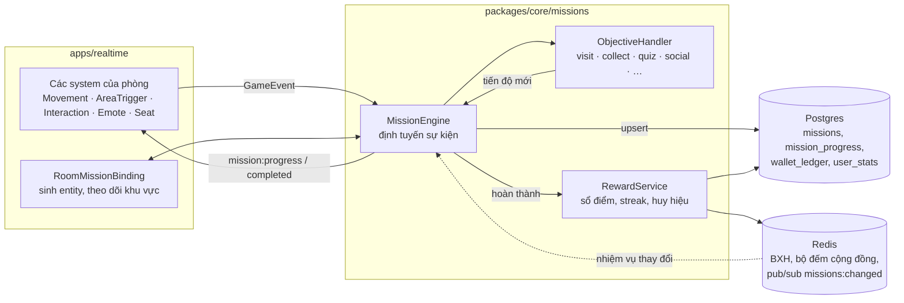
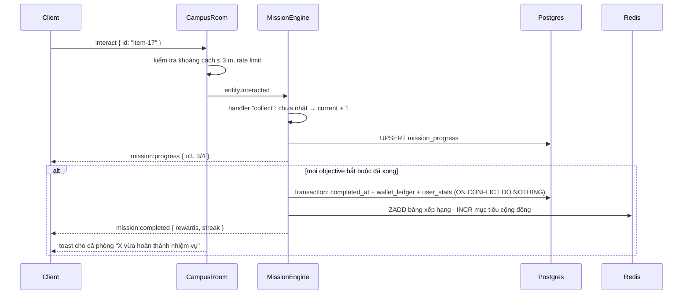
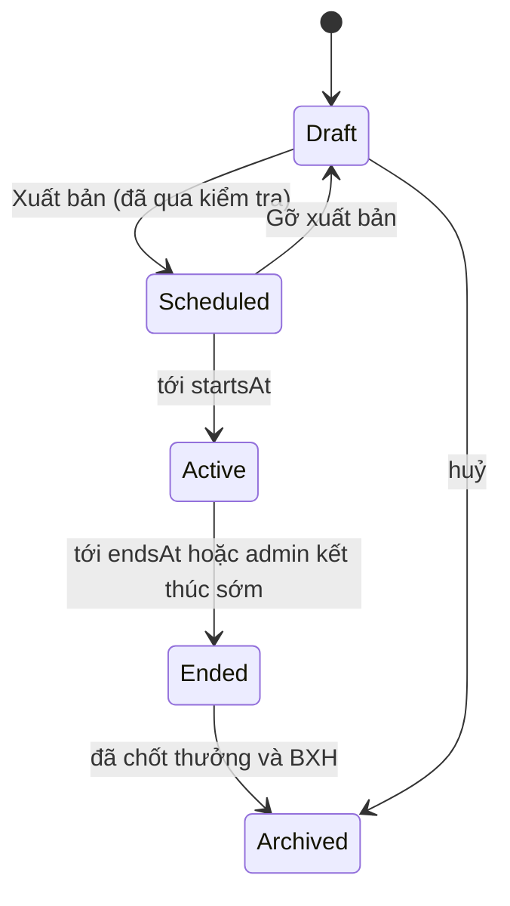

# 06 — Hệ thống nhiệm vụ

Đây là tính năng lõi: **mỗi ngày admin tạo một nhiệm vụ hệ thống, người chơi hoàn thành bằng cách tương tác trong map.**

## 1. Nguyên tắc thiết kế

1. **Nhiệm vụ là dữ liệu.** Một nhiệm vụ là một tài liệu JSON ghép từ các *objective* thuộc một danh mục loại có sẵn. Tạo nhiệm vụ mới không cần deploy code.
2. **Server quyết định.** Client không bao giờ nói "tôi đã xong". Client chỉ gửi *ý định* (đi tới đâu, bấm vào cái gì, chọn đáp án nào); server tự suy ra tiến độ.
3. **Hướng sự kiện.** Realtime phát ra các sự kiện game; engine chuyển chúng tới objective đang hoạt động.
4. **Trao thưởng đúng một lần.** Mọi thao tác ghi tiến độ và phần thưởng đều idempotent.
5. **Mở rộng bằng cách thêm loại objective**, không sửa engine.
6. **Thân thiện nơi công sở.** Không phạt người nghỉ cuối tuần hay nghỉ phép; không có phần thưởng tiền thật.

## 2. Khái niệm

| Khái niệm | Ý nghĩa |
|---|---|
| **Mission** | Một nhiệm vụ có thời gian bắt đầu/kết thúc, gồm nhiều objective và phần thưởng |
| **Objective** | Một mục tiêu con: loại + tham số + số lượng cần đạt |
| **Entity** | Vật thể nhiệm vụ đặt vào thế giới: vật phẩm, kiosk, NPC, điểm đánh dấu |
| **Progress** | Trạng thái của một người với một nhiệm vụ |
| **Reward** | Điểm, kinh nghiệm, vật phẩm cosmetic, huy hiệu |
| **Template** | Nhiệm vụ mẫu để nhân bản nhanh hoặc tự điền ngày trống |

## 3. Mô hình dữ liệu

Định nghĩa ở `packages/shared/src/missions.ts` (kiểu + zod schema), dùng chung cho API, realtime, admin và client. Engine ở `packages/core/src/missions` (`engine.ts` định tuyến sự kiện, `handlers/*` từng loại objective, `rewards.ts` luật thưởng, `store.ts` đọc/ghi DB). Nhiệm vụ mẫu ở `tools/mission-tools/examples`; nạp bằng `pnpm missions:load <file.json> [--draft] [--today]` và `pnpm quiz:load <file.json>`.

```ts
type MissionKind = 'daily' | 'weekly' | 'event' | 'onboarding';

interface MissionDefinition {
  id: string;
  kind: MissionKind;
  title: LocalizedText;
  description: LocalizedText;
  coverImage?: string;
  startsAt: string;                      // ISO UTC
  endsAt: string;
  mapVersion: string;                    // phiên bản map-data lúc soạn
  objectiveMode: 'all' | 'sequential' | { anyOf: number };
  objectives: ObjectiveDefinition[];
  rewards: Reward[];                     // khi hoàn thành
  bonusWindows?: Array<{ from: string; to: string; multiplier: number }>;   // "giờ vàng", HH:mm giờ VN
  rankRewards?: Array<{ fromRank: number; toRank: number; rewards: Reward[] }>;
  communityGoal?: { metric: 'completions'; target: number; rewards: Reward[] };
  audience?: { departments?: string[] }; // mặc định: tất cả
}

interface ObjectiveDefinition {
  id: string;                            // ổn định trong nhiệm vụ: 'o1', 'o2'…
  type: ObjectiveType;
  title: LocalizedText;
  hint?: LocalizedText;
  target: number;                        // số lượng cần đạt
  optional?: boolean;
  params: unknown;                       // theo schema riêng của từng loại
}

type Reward =
  | { type: 'points'; amount: number }
  | { type: 'xp'; amount: number }
  | { type: 'item'; itemId: string }
  | { type: 'badge'; badgeId: string };

interface MissionProgress {
  missionId: string;
  userId: string;
  objectives: Record<string, { current: number; done: boolean; data?: unknown }>;
  startedAt: string;                     // lần đầu có tiến độ
  completedAt?: string;
  durationMs?: number;                   // completedAt − startedAt
}
```

## 4. Danh mục objective

### MVP (P4)

| Loại | Ý nghĩa | Tham số chính | Sự kiện kích hoạt | Server kiểm tra |
|---|---|---|---|---|
| `visit` | Ghé một hoặc nhiều địa điểm | `targets` (khu vực hoặc POI + bán kính), `mode: all/any`, `dwellSec?` | `area.entered`, `area.dwell` | Vị trí do server nắm; thời gian đứng lại đo bằng đồng hồ server |
| `collect` | Thu thập N vật phẩm | `item`, `source` (bộ điểm `spawnSet` hoặc danh sách toạ độ), `scope: perPlayer/shared`, `respawnSec?` | `entity.interacted` | Khoảng cách ≤ 3 m, vật chưa bị nhặt, rate limit |
| `quiz` | Trả lời câu hỏi tại kiosk/NPC | `at` (POI), `from` (id câu hỏi hoặc tag + số câu), `maxAttempts`, trộn thứ tự | `entity.interacted` → `quiz.answered` | Đáp án chỉ nằm trên server; giới hạn số lần thử |
| `social` | Emote hướng tới N đồng nghiệp khác nhau | `emote`, `radius`, `mutual?` | `emote.performed` | Đếm userId khác nhau trong bán kính; mỗi người chỉ tính một lần |

### V1 (P6–P7)

| Loại | Ý nghĩa | Tham số chính | Ghi chú |
|---|---|---|---|
| `gather` | ≥ N người cùng đứng trong một khu | `areaId`, `minPlayers`, `holdSec` | Mọi người đang đứng trong khu đều được tính; tạo khoảnh khắc tập thể |
| `emote_at` | Diễn emote hoặc ngồi tại một chỗ trong T giây | `areaId`/`poiId`, `emote`/`sit`, `durationSec` | "Ngồi cạnh hồ Koi 60 giây" |
| `photo` | Chụp ảnh tại điểm chụp | `poiId` | Server chỉ kiểm tra vị trí; ảnh lưu ở máy người chơi |
| `deliver` | Lấy đồ ở A, giao tới B | `from`, `to`, `timeLimitSec?` | Avatar hiện vật đang bê |
| `race` | Qua các checkpoint theo thứ tự trong T giây | `checkpoints[]`, `timeLimitSec`, `radius` | Server bấm giờ |
| `find` | Tìm linh vật đang trốn, đổi chỗ định kỳ | `npc`, `spots` (spawnSet), `moveEverySec` | |

`scope: perPlayer` nghĩa là mỗi người có bộ vật phẩm riêng, vị trí sinh ngẫu nhiên theo hạt giống `userId + missionId` — chỉ chỗ cho nhau trong chat không làm mất vui. `scope: shared` là ai nhanh thì được, dùng khi muốn cạnh tranh.

## 5. Kiến trúc engine



### 5.1 Sự kiện game

```ts
type GameEvent =
  | { type: 'area.entered' | 'area.left'; userId: string; areaId: string }
  | { type: 'area.dwell'; userId: string; areaId: string; seconds: number }
  | { type: 'entity.interacted'; userId: string; entityId: string; action?: string }
  | { type: 'emote.performed'; userId: string; emote: string; nearbyUserIds: string[] }
  | { type: 'quiz.answered'; userId: string; questionId: string; choice: number; correct: boolean }  // `correct` do server tra ngân hàng câu hỏi
  | { type: 'seat.taken'; userId: string; seatId: string }
  | { type: 'tick'; roomId: string };          // 1 Hz, cho objective theo thời gian và tập thể
```

Server tự sinh `area.*` từ vị trí người chơi: 4 lần mỗi giây, `AreaTriggerSystem` kiểm tra điểm-trong-đa-giác, nhưng **chỉ với những khu vực đang được nhiệm vụ nào đó tham chiếu** (vài chục khu × 100 người — không đáng kể).

### 5.2 Giao diện của một loại objective

```ts
interface ObjectiveHandler<P, S> {
  type: ObjectiveType;
  paramsSchema: z.ZodType<P>;                 // validate + sinh form trong admin
  events: GameEvent['type'][];                // loại sự kiện muốn nhận
  init(ctx: MissionCtx, params: P, player: PlayerRef): S;
  onEvent(ctx: MissionCtx, params: P, state: S, ev: GameEvent): { state: S; current: number } | null;
  sharedEntities?(ctx: MissionCtx, params: P): EntitySpec[];                    // mọi người đều thấy
  privateEntities?(ctx: MissionCtx, params: P, state: S, player: PlayerRef): EntitySpec[];  // chỉ người này thấy
  clientView(params: P, state: S): unknown;   // phần an toàn để gửi client (không có đáp án)
}
```

Handler là hàm gần như thuần: nhận trạng thái cũ + sự kiện, trả trạng thái mới. Nhờ vậy test được bằng unit test mà không cần server hay trình duyệt.

### 5.3 Runtime

| Cấp | Đối tượng | Nhiệm vụ |
|---|---|---|
| Tiến trình | `MissionRuntime` | Giữ danh sách nhiệm vụ đang chạy; làm mới từ DB mỗi 15 giây và ngay khi nhận `missions:changed` qua Redis |
| Phòng | `RoomMissionBinding` | Đưa entity dùng chung vào state phòng; khai báo khu vực cần theo dõi; phát `tick` |
| Người chơi | `PlayerMissionState` | Nạp tiến độ khi vào phòng; tính entity riêng; ghi tiến độ qua hàng đợi tuần tự của riêng người đó |

Vì mỗi người chỉ có một phiên tại một thời điểm (xem [05](05-multiplayer.md)), tiến độ của một người chỉ có **một nơi ghi** — không cần khoá phân tán.

**Đã làm (P4.2):** `apps/realtime/src/missions` — `MissionRuntime` làm mới từ Postgres mỗi 15 giây (chưa có Redis nên chưa có `missions:changed`), nạp cả ngân hàng câu hỏi vào bộ nhớ; `RoomMissionBinding` là TypeScript thuần nhận hook từ phòng (gửi tin, vị trí đã duyệt, danh sách người chơi) nên test được không cần Colyseus. Mỗi người một hàng đợi ghi tuần tự; ghi DB lỗi thì không đổi gì và không báo. Vật phẩm `shared` bị giữ chỗ ngay khi có người nhặt (trước khi ghi) để không ai nhặt trùng. Danh tính dev (không phải UUID) vẫn chơi được nhưng không lưu. Vị trí dùng để kiểm tra khu vực/khoảng cách luôn là vị trí server đã duyệt.

### 5.4 Luồng xử lý một tương tác



Quy tắc ghi: **ghi DB thành công rồi mới báo client.** DB lỗi thì không đổi trạng thái trong bộ nhớ; client hoàn tác hiệu ứng và người chơi bấm lại.

## 6. Vòng đời và lịch



DB chỉ lưu `publish_status` (`draft` / `published` / `archived`); "đang chạy" hay "đã kết thúc" suy ra từ thời gian. Không có job nào phải "bật" nhiệm vụ đúng giờ nên không có gì để lỡ.

| Quy tắc | Chi tiết |
|---|---|
| Một nhiệm vụ ngày mỗi ngày | Ràng buộc duy nhất theo (`kind = daily`, ngày theo giờ Việt Nam). Vẫn cho phép chạy song song nhiệm vụ sự kiện, tuần, onboarding |
| Khung giờ | Mặc định 00:00–23:59 giờ VN; admin đặt khung hẹp hơn được (ví dụ 09:00–18:00) |
| Giờ vàng | Hệ số thưởng trong một khung giờ để kéo mọi người vào cùng lúc |
| Bắt đầu | Realtime phát hiện (tối đa trễ 15 giây), sinh entity, hiện biểu ngữ cho người đang online |
| Kết thúc | Ngừng nhận tiến độ, gỡ entity. Job chốt chạy sau 1 phút: tính hạng, trao thưởng hạng, lưu ảnh chụp BXH và số liệu tổng kết |
| Sửa nhiệm vụ đang chạy | Chỉ được sửa chữ (tiêu đề, gợi ý) và tăng thưởng. Sửa cấu trúc → kết thúc sớm rồi nhân bản |
| Ngày trống | Lúc 23:00, job kiểm tra ngày mai; nếu chưa có nhiệm vụ ngày thì lấy một template từ kho xoay vòng (không lặp trong N ngày), đánh dấu "tự điền", báo cho biên tập viên |
| Xem thử | Người có quyền biên tập mở game với `?preview=<missionId>`: chỉ người đó thấy entity của bản nháp; tiến độ không tính vào BXH |
| Onboarding | Một nhiệm vụ `onboarding` thường trực dạy đi lại, emote, tương tác — dùng chính engine này |

## 7. Phần thưởng

| Thành phần | Thiết kế |
|---|---|
| **Điểm** | Nhận từ nhiệm vụ, điểm danh, mốc streak. Tiêu ở cửa hàng cosmetic (V1). Mọi thay đổi đi qua **sổ cái** `wallet_ledger`, không sửa số dư trực tiếp |
| **Kinh nghiệm & cấp** | Chỉ để khoe; cấp hiện trên thẻ tên. Cấp n cần 50·n·(n−1) kinh nghiệm (100, 300, 600, 1.000…) |
| **Streak** | Số ngày liên tiếp hoàn thành nhiệm vụ ngày. **Chỉ tính ngày làm việc**: cuối tuần, ngày lễ (danh sách ở `settings.holidays`) và ngày không có nhiệm vụ không làm đứt streak. Mốc thưởng 3 / 7 / 14 / 30 ngày: +20 / 50 / 100 / 200 điểm |
| **Huy hiệu** | Thành tích đặc biệt, hiện trên hồ sơ |
| **Thưởng hạng** | Nhỏ, mang tính ghi nhận — tránh biến trò chơi thành cuộc đua căng thẳng |
| **Mục tiêu cộng đồng** | Cả công ty cùng đạt một con số → mọi người tham gia đều nhận thưởng |

**Idempotent:** `wallet_ledger` có ràng buộc duy nhất `(user_id, currency, ref_type, ref_id)`, ví dụ `(u1, points, mission, m42)`. Ghi lần hai là không có tác dụng.

**Bảng xếp hạng** (thiết kế: Redis sorted set, chụp về Postgres cuối kỳ; **đã làm ở P4.4: tính thẳng từ Postgres** — `wallet_ledger` có index `(currency, created_at)`, `mission_progress` có index `(mission_id, completed_at)` — xem DECISIONS):

| Bảng | Khoá | Điểm số |
|---|---|---|
| Nhiệm vụ ngày | `lb:mission:{missionId}` | `durationMs` — tính từ lúc người đó bắt đầu, nên vào muộn không thiệt |
| Điểm tuần / tháng / mọi thời điểm | `lb:points:week:{tuần ISO}` … | Tổng điểm |
| Phòng ban theo tuần | `lb:dept:week:{tuần ISO}` | Điểm trung bình trên đầu người có tham gia (job tính lại định kỳ) để phòng nhỏ không thiệt |

## 8. Trình bày phía client

- **Biểu ngữ** khi vào game và khi có nhiệm vụ mới: tên, mô tả, thưởng, đếm ngược.
- **Bảng theo dõi** thu gọn trên HUD: từng objective với tiến độ `3/5`.
- **Chỉ đường:** mũi tên la bàn ở mép màn hình + cột sáng tại đích + khoảng cách. Objective kiểu "tìm kiếm" thì chỉ khoanh vùng, không chỉ đích.
- **Vật thể nhiệm vụ** có viền sáng và gợi ý tương tác.
- **Hoàn thành:** hiệu ứng ăn mừng, bảng phần thưởng, streak, thứ hạng tạm thời, nút tạo ảnh chia sẻ.
- Mỗi loại objective có một *presenter* phía client (`game/missions/presenters`) quyết định điểm đánh dấu và giao diện riêng (ví dụ hộp thoại quiz).

**Đã làm (P4.3):** `apps/web/src/game/missions` (kho trạng thái, vật thể 3D, đích chỉ đường) và `apps/web/src/ui/MissionHud.tsx` (biểu ngữ, bảng theo dõi, la bàn, quiz, màn hoàn thành). Biểu ngữ hiện mỗi lần vào game khi còn nhiệm vụ chưa xong. Chỉ đường là **một la bàn ở giữa mép trên** (mũi tên xoay theo camera + khoảng cách + tên đích) cộng cột sáng tại đích, thay vì mũi tên chạy theo mép màn hình. Vật phẩm tạm: ly cà phê hoặc viên đá quý xoay trên vòng sáng; kiosk là khối cam có dấu "?". Đứng trong 2,6 m thì nút hành động (phím E) đổi thành "Nhặt …" / "Trả lời câu hỏi" (ưu tiên hơn ghế). Chưa tách presenter theo từng loại: một hàm `waypointTarget` xử lý cả bốn loại.

## 9. Chống gian lận (mức tương xứng với giá trị phần thưởng)

| Nguy cơ | Biện pháp |
|---|---|
| Giả vị trí để "ghé điểm" | Dùng vị trí server đã kiểm tra tốc độ và biên |
| Bấm nhặt từ xa | Server kiểm tra khoảng cách tới vật thể |
| Lộ đáp án quiz | Đáp án không gửi về client; trộn thứ tự câu và lựa chọn; giới hạn số lần thử |
| Chia sẻ vị trí vật phẩm | `perPlayer`: mỗi người một bộ vị trí riêng |
| Dùng nhiều tài khoản để tự chào nhau | `social` chỉ tính tài khoản đã liên kết danh tính thật (cấu hình được); mỗi người đếm một lần |
| Tự động hoá bằng script | Rate limit tương tác; hoàn thành nhanh hơn ngưỡng tối thiểu hợp lý → đánh dấu để admin xem, **không tự động phạt** |
| Trao thưởng trùng | Ràng buộc duy nhất ở sổ cái |

## 10. Tình huống biên

| Tình huống | Hành vi |
|---|---|
| Rớt mạng giữa chừng | Tiến độ đã lưu DB; vào lại nhận `mission:state` đầy đủ |
| Server khởi động lại | Như trên; entity dùng chung được sinh lại từ định nghĩa |
| Hết giờ khi đang làm dở | Tiến độ dừng lại; hiện bảng tổng kết; không tính hoàn thành |
| Qua ngày khi đang online | Nhiệm vụ cũ đóng, biểu ngữ nhiệm vụ mới hiện ngay tại chỗ |
| Admin gỡ nhiệm vụ đang chạy | Entity biến mất, tiến độ giữ nguyên trong DB để tra cứu |
| Map đổi sau khi soạn nhiệm vụ | So `mapVersion`; nhiệm vụ tham chiếu POI/khu vực không còn tồn tại thì bị chặn xuất bản |
| Chuyển kênh giữa chừng | Tiến độ theo người, không theo phòng; vật phẩm `shared` có thể khác trạng thái ở kênh mới |
| Quá ít người cho objective tập thể | Admin thấy cảnh báo khi đặt `minPlayers` cao hơn số online trung bình của khung giờ đó |

## 11. Ví dụ định nghĩa nhiệm vụ

```json
{
  "kind": "daily",
  "title": { "vi": "Chào tuần mới" },
  "description": { "vi": "Điểm danh, chào đồng nghiệp và nạp cà phê cho ngày thứ Hai." },
  "startsAt": "2026-11-15T17:00:00Z",
  "endsAt": "2026-11-16T16:59:59Z",
  "mapVersion": "1.0.0",
  "objectiveMode": "all",
  "objectives": [
    { "id": "o1", "type": "visit", "title": { "vi": "Điểm danh ở cổng chính" }, "target": 1,
      "params": { "targets": [{ "areaId": "area.gate_main" }], "mode": "all" } },
    { "id": "o2", "type": "social", "title": { "vi": "Vẫy tay chào 5 đồng nghiệp" }, "target": 5,
      "params": { "emote": "wave", "radius": 4 } },
    { "id": "o3", "type": "collect", "title": { "vi": "Tìm 4 ly cà phê quanh campus" }, "target": 4,
      "params": { "item": "coffee_cup", "source": { "spawnSet": "outdoor_common" }, "scope": "perPlayer" } },
    { "id": "o4", "type": "quiz", "title": { "vi": "Trả lời đúng 2 câu ở quầy lễ tân" }, "target": 2,
      "params": { "at": { "poiId": "poi.kiosk.lobby" }, "from": { "tags": ["van-hoa"], "pick": 3 }, "maxAttempts": 2 } }
  ],
  "rewards": [{ "type": "points", "amount": 100 }, { "type": "xp", "amount": 50 }],
  "bonusWindows": [{ "from": "12:00", "to": "13:30", "multiplier": 1.5 }],
  "communityGoal": { "metric": "completions", "target": 300,
    "rewards": [{ "type": "badge", "badgeId": "team_spirit_2026w47" }] }
}
```

Nhiệm vụ này chạy trọn ngày thứ Hai 16/11/2026 theo giờ Việt Nam.

## 12. Thêm một loại objective mới

1. Khai báo `type` và `paramsSchema` trong `packages/shared/missions`.
2. Viết handler trong `packages/core/missions/handlers` kèm unit test.
3. Nếu cần sự kiện game mới: phát nó từ system tương ứng trong realtime.
4. Viết presenter phía client (điểm đánh dấu, giao diện riêng nếu có).
5. Form admin tự sinh từ schema; thêm widget riêng khi cần (ví dụ vẽ đường chạy trên bản đồ).
6. Thêm một template mẫu và một kịch bản e2e.
