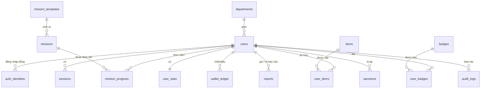

# 07 — Backend & dữ liệu

## 1. Dịch vụ và module

| Tiến trình | Module | Ghi chú |
|---|---|---|
| `apps/api` (vai trò `api`) | `auth`, `users`, `world`, `presence`, `missions`, `leaderboards`, `shop`, `reports`, `admin/*` | Không giữ trạng thái; chạy nhiều bản sao được |
| `apps/api` (vai trò `worker`) | Các job BullMQ | Cùng mã nguồn, khởi động bằng `ROLE=worker` |
| `apps/realtime` | Phòng + các system + mission runtime | Xem [05](05-multiplayer.md) |

Cả ba gọi vào `packages/core` (nghiệp vụ) và `packages/db` (truy cập dữ liệu). Giao tiếp giữa các tiến trình chỉ qua **Postgres** (trạng thái bền) và **Redis pub/sub** (tín hiệu).

**Một origin duy nhất:** `https://<domain>/` phục vụ app tĩnh, `/api` là REST, `/rt` là WebSocket. Cùng origin giúp cookie đăng nhập hoạt động ổn định trong trình duyệt nhúng và không cần cấu hình CORS phức tạp.

## 2. Schema cơ sở dữ liệu (PostgreSQL)

### 2.1 Danh tính

| Bảng | Cột chính | Ghi chú |
|---|---|---|
| `users` | `id` (UUIDv7), `display_name`, `email?` (unique), `is_guest`, `role` (player/editor/moderator/admin), `status` (active/muted/banned), `department_id?`, `title?`, `avatar` (chuỗi cấu hình), `locale`, `hide_presence`, `consent_version`, `created_at`, `last_seen_at` | |
| `auth_identities` | `user_id`, `provider` (guest/google/microsoft/oidc/zalo), `subject` | Unique `(provider, subject)`; một người có thể có nhiều danh tính |
| `sessions` | `user_id`, `refresh_hash`, `family_id`, `expires_at`, `revoked_at?`, `user_agent` | Chỉ lưu hash của refresh token |
| `departments` | `id`, `name`, `parent_id?` | Nhập từ CSV hoặc từ claim của IdP |

### 2.2 Nhiệm vụ

| Bảng | Cột chính | Ghi chú |
|---|---|---|
| `missions` | `id`, `kind`, `publish_status`, `title`, `description` (jsonb), `starts_at`, `ends_at`, `daily_date?`, `definition` (jsonb: objectives, rewards, …), `map_version`, `template_id?`, `auto_filled`, `version`, `created_by`, `updated_by` | Unique có điều kiện: mỗi `daily_date` chỉ một nhiệm vụ `daily` đã xuất bản. Index `(starts_at, ends_at)` |
| `mission_templates` | `id`, `name`, `definition` (jsonb), `tags`, `active`, `last_used_on?` | Kho mẫu cho tự điền |
| `mission_progress` | PK `(mission_id, user_id)`, `state` (jsonb theo objective), `started_at`, `completed_at?`, `duration_ms?`, `rank?`, `is_preview` | Index `(mission_id, completed_at)` |
| `mission_stats` | PK `mission_id`, `participants`, `completions`, `median_duration_ms`, `computed_at` | Job chốt ghi |
| `quiz_questions` | `id`, `text`, `choices` (jsonb), `correct_index`, `explanation?`, `tags` (text[]), `active` | Ngân hàng câu hỏi |

### 2.3 Phần thưởng

| Bảng | Cột chính | Ghi chú |
|---|---|---|
| `wallet_ledger` | `id`, `user_id`, `currency` (points/xp), `delta`, `reason`, `ref_type`, `ref_id`, `created_at` | **Unique `(user_id, currency, ref_type, ref_id)`** → trao thưởng idempotent |
| `user_stats` | PK `user_id`, `points`, `xp`, `level`, `streak_current`, `streak_best`, `last_daily_date?`, `missions_completed` | Cập nhật cùng transaction với sổ cái |
| `items` | `id`, `type` (hair/top/accessory/emote/…), `name`, `asset_key`, `price_points?`, `available_from?`, `available_to?`, `active` | Danh mục cosmetic |
| `user_items` | PK `(user_id, item_id)`, `source`, `acquired_at` | |
| `badges`, `user_badges` | `id`, `name`, `icon`, `description` · PK `(user_id, badge_id)`, `awarded_at` | |
| `leaderboard_snapshots` | `board`, `period`, `rank`, `subject_id`, `score` | Ảnh chụp cuối kỳ từ Redis |

### 2.4 Vận hành

| Bảng | Cột chính | Ghi chú |
|---|---|---|
| `announcements` | `id`, `level`, `text` (jsonb), `starts_at`, `ends_at`, `created_by` | |
| `reports` | `id`, `reporter_id`, `target_user_id`, `reason`, `note?`, `context` (jsonb: đoạn chat xung quanh), `status`, `handled_by?`, `handled_at?` | |
| `sanctions` | `id`, `user_id`, `type` (mute/ban), `reason`, `starts_at`, `ends_at?`, `created_by` | |
| `audit_logs` | `id`, `actor_id`, `action`, `entity_type`, `entity_id`, `diff` (jsonb), `created_at` | Mọi thao tác admin |
| `settings` | PK `key`, `value` (jsonb), `updated_by`, `updated_at` | Cấu hình và cờ tính năng |
| `analytics_events` | `ts`, `user_id?`, `name`, `props` (jsonb) | Phân vùng theo tháng; có thời hạn lưu |

## 3. Redis

| Khoá / kênh | Kiểu | Dùng để |
|---|---|---|
| `presence:user:{userId}` | hash, hết hạn 60 giây, làm mới định kỳ | Kênh, khu vực, trạng thái hiện tại |
| `presence:online` | sorted set | Danh sách online |
| `channels` | hash | Số người từng kênh (realtime ghi mỗi 5 giây) |
| `session:user:{userId}` | string | Bảo đảm một người một phiên |
| `lastpos:{userId}` | string, hết hạn 24 giờ | Vị trí cuối |
| `lb:*` | sorted set | Bảng xếp hạng |
| `community:{missionId}` | counter | Mục tiêu cộng đồng |
| `chatbuf:{roomId}` | list tối đa 200, hết hạn 24 giờ | Ngữ cảnh cho báo cáo vi phạm |
| `rl:{phạm vi}:{id}` | counter có hạn | Rate limit |
| `cache:missions:active` | JSON, hết hạn 15 giây | Cache nhiệm vụ đang chạy |
| Pub/sub: `missions:changed`, `announce`, `moderation`, `settings:changed` | — | Tín hiệu giữa API và realtime |
| `bull:*` | — | Hàng đợi BullMQ |

Mất toàn bộ Redis không làm mất dữ liệu gốc: BXH dựng lại được từ `wallet_ledger` và `mission_progress`.

## 4. REST API (tiền tố `/api/v1`)

### Xác thực và tài khoản

| Method | Đường dẫn | Mô tả |
|---|---|---|
| POST | `/auth/guest` | Tạo tài khoản khách từ tên hiển thị; trả mã khôi phục |
| POST | `/auth/guest/recover` | Lấy lại tài khoản khách bằng mã khôi phục |
| GET | `/auth/oidc/:provider/start` · `/callback` | Đăng nhập OIDC |
| POST | `/auth/link/:provider` | Gắn danh tính thật vào tài khoản khách, giữ nguyên tiến độ |
| POST | `/auth/refresh` · `/auth/logout` | Làm mới token · đăng xuất |
| GET / PATCH / DELETE | `/me` | Hồ sơ; sửa tên, avatar, tuỳ chọn riêng tư; yêu cầu xoá dữ liệu |

### Thế giới

| Method | Đường dẫn | Mô tả |
|---|---|---|
| GET | `/world/bootstrap` | Phiên bản map, URL manifest asset, kênh gợi ý + địa chỉ realtime, cờ tính năng, thông báo đang hiệu lực |
| GET | `/world/channels` | Danh sách kênh và số người |
| GET | `/presence/online?q=` · `/presence/summary` | Ai đang online · tổng số theo kênh/khu |

### Nhiệm vụ và phần thưởng

| Method | Đường dẫn | Mô tả |
|---|---|---|
| GET | `/missions/active` · `/missions/:id` · `/missions/history` | Nhiệm vụ đang chạy · chi tiết · lịch sử của tôi |
| GET | `/leaderboards/:board?period=&around=me` | Bảng xếp hạng |
| GET | `/me/stats` · `/me/items` · `/items` | Chỉ số, tủ đồ, danh mục |
| POST | `/shop/purchase` | Đổi điểm lấy cosmetic (V1) |
| POST | `/reports` | Báo cáo vi phạm |

Tiến độ nhiệm vụ **không có endpoint ghi**: chỉ realtime ghi được, dựa trên sự kiện trong thế giới.

### Admin (`/api/v1/admin`, cần quyền)

| Nhóm | Endpoint |
|---|---|
| Nhiệm vụ | CRUD `/missions`; `POST /missions/validate`; `POST /missions/:id/publish` · `unpublish` · `end` · `duplicate`; `GET /missions/:id/stats` |
| Mẫu, quiz | CRUD `/templates`, `/quiz` (+ nhập CSV) |
| Thông báo | CRUD `/announcements`; `POST /announcements/:id/broadcast` |
| Người dùng | `GET /users`; `PATCH /users/:id/role`; `POST` / `DELETE /users/:id/sanctions` |
| Kiểm duyệt | `GET /reports`; `POST /reports/:id/resolve` |
| Số liệu | `GET /stats/overview` · `/stats/missions` |
| Hệ thống | `GET` / `PUT /settings`; `GET /audit-logs` |

## 5. Xác thực

### 5.1 Mô hình token

| Token | Dạng | Thời hạn | Lưu ở đâu |
|---|---|---|---|
| Access | JWT ký bất đối xứng (ES256/EdDSA); claim: `sub`, `role`, `name`, `sid` | 15 phút | Bộ nhớ của trang |
| Refresh | Chuỗi ngẫu nhiên, DB chỉ lưu hash | 30 ngày, **xoay vòng mỗi lần dùng**; phát hiện dùng lại → thu hồi cả chuỗi phiên | Cookie `HttpOnly; Secure; SameSite=Lax`, phạm vi `/api/v1/auth` |

- API giữ khoá riêng để ký. Realtime chỉ có **khoá công khai** — kiểm tra được token nhưng không phát hành được.
- WebSocket: access token nằm trong tuỳ chọn khi vào phòng (đi trong thân request, không nằm trên URL nên không lọt vào log).
- Phiên đang mở không cần xác thực lại khi access token hết hạn. Khoá tài khoản có hiệu lực ngay nhờ tín hiệu `moderation` qua Redis.

### 5.2 Nhà cung cấp danh tính (cắm rời)

| Provider | Cách hoạt động | Khi nào dùng |
|---|---|---|
| `guest` | Nhập tên hiển thị → tạo tài khoản gắn với thiết bị; có mã khôi phục | Giai đoạn dựng, demo, khách tham quan |
| `google` / `microsoft` / `oidc` | Authorization Code + PKCE. Chỉ nhận email đã xác minh thuộc **danh sách domain cho phép** (cấu hình) | Chế độ nội bộ |
| `zalo` | OAuth của Zalo qua adapter riêng | Khi làm Zalo Mini App (V2) |

Chính sách khách cấu hình được qua `GUEST_MODE = off | limited | full`. Ở mức `limited`: khách đi lại và emote được, nhưng không chat, không lên BXH, không được tính trong objective `social`.

Liên kết tài khoản: khách đăng nhập OIDC khi đang có phiên → danh tính mới gắn vào tài khoản hiện tại, tiến độ giữ nguyên. Nếu danh tính đó đã thuộc tài khoản khác → chuyển sang tài khoản thật, bỏ tài khoản khách.

### 5.3 Phân quyền

Vai trò nằm trong claim `role`. Endpoint admin yêu cầu tài khoản không phải khách và đúng vai trò (ma trận quyền ở [08](08-admin-cms.md)). Quản trị viên đầu tiên khai báo qua biến môi trường `ADMIN_EMAILS`.

## 6. Job nền (BullMQ)

| Job | Lịch | Việc làm |
|---|---|---|
| `mission-finalize` | 1 phút sau `endsAt` của mỗi nhiệm vụ | Tính hạng, trao thưởng hạng, chụp BXH, ghi `mission_stats` (idempotent) |
| `daily-autofill` | 23:00 giờ VN | Ngày mai chưa có nhiệm vụ ngày → sinh từ kho mẫu, báo biên tập viên |
| `dept-leaderboard` | Mỗi 10 phút | Tính lại BXH phòng ban |
| `leaderboard-snapshot` | Cuối tuần, cuối tháng | Chụp BXH về Postgres |
| `presence-sweep` | Mỗi phút | Dọn presence quá hạn |
| `analytics-rollup` | Hằng giờ | Tổng hợp số liệu cho dashboard |
| `data-retention` | Hằng ngày | Xoá khách không hoạt động quá 30 ngày, sự kiện analytics quá hạn, phiên hết hạn |

## 7. Cấu hình và cờ tính năng

| Loại | Ví dụ | Nơi đặt |
|---|---|---|
| Bí mật, hạ tầng | Chuỗi kết nối DB/Redis, khoá ký JWT, client secret của IdP | Biến môi trường |
| Vận hành | Ngưỡng mềm/cứng của kênh, bật/tắt chat cả kênh, `GUEST_MODE`, danh sách domain email | Bảng `settings` (sửa trong admin, có hiệu lực ngay qua pub/sub) |
| Cờ tính năng | Cửa hàng, voice, loại objective mới | Bảng `settings`, gửi cho client qua `/world/bootstrap` |
| Lịch làm việc | Ngày lễ, ngày không tính streak | Bảng `settings` |

## 8. Sự kiện analytics

| Sự kiện | Thuộc tính | Dùng để |
|---|---|---|
| `session_start` / `session_end` | thiết bị, mức chất lượng, thời lượng | DAU, thời lượng phiên |
| `world_loaded` | mili-giây, lần đầu hay lần sau, dung lượng tải | Theo dõi tốc độ vào game |
| `perf_sample` | FPS trung vị, mức chất lượng, số avatar hiển thị | Hiệu năng theo nhóm thiết bị |
| `mission_viewed` / `objective_progress` / `mission_completed` | missionId, objectiveId, thời gian | Phễu nhiệm vụ |
| `emote_used`, `chat_sent`, `seat_taken` | chỉ đếm, không lưu nội dung | Mức độ giao lưu |
| `channel_switched`, `colleague_found` | — | Hành vi tìm nhau |
| `client_error` | mã lỗi | Chất lượng |

Dashboard chỉ hiển thị **số liệu tổng hợp**. Không có màn hình nào cho xem lịch sử online của một cá nhân cụ thể.
