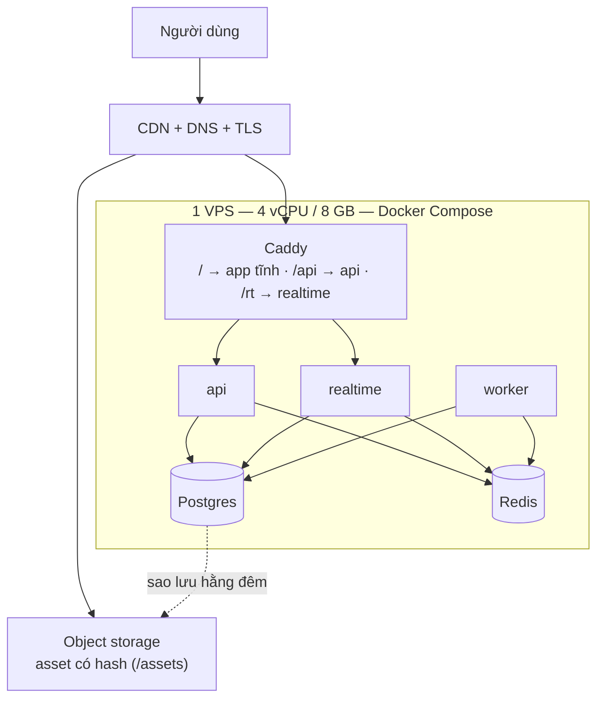

# 09 — Hạ tầng, bảo mật & pháp lý

## 1. Môi trường

| Môi trường | Mục đích | Cấu hình |
|---|---|---|
| **Local** | Phát triển | `docker compose` chạy Postgres + Redis; các app chạy bằng `pnpm dev` |
| **Staging** | Thử trước khi phát hành, pilot nhóm nhỏ | Giống production, máy nhỏ hơn, dữ liệu riêng; tự deploy khi merge vào nhánh chính |
| **Production** | Người dùng thật | Deploy thủ công có phê duyệt, theo tag phiên bản |

## 2. Các bậc triển khai

### Bậc 0 — một máy (MVP, pilot, tới vài trăm người đồng thời)

### Bậc 1 — tách dữ liệu, nhân đôi (tới vài nghìn người đồng thời)

- Postgres và Redis chuyển sang dịch vụ quản lý (có sao lưu theo thời điểm).
- 2 máy ứng dụng. `api` chạy nhiều bản sau cân bằng tải.
- `realtime` chạy nhiều tiến trình (mỗi nhân CPU một tiến trình), bật Redis presence + driver; mỗi tiến trình có địa chỉ công khai riêng dạng `/rt/<cổng>/…`.

### Bậc 2 — co giãn (công khai, hàng chục nghìn người)

- Điều phối container có tự co giãn theo số người; hàng chờ khi quá tải; bản sao chỉ đọc cho DB.
- Lúc này mới đáng đánh giá lại phương án edge/serverless (xem ADR-03 ở [02](02-architecture.md)).

### Chi phí ước lượng (rất thô, cần kiểm tra giá lúc triển khai)

| Bậc | Thành phần | Mỗi tháng |
|---|---|---|
| 0 | 1 VPS 4 vCPU/8 GB, CDN gói miễn phí, object storage vài GB, tên miền | khoảng 30–60 USD |
| 1 | 2 máy ứng dụng + Postgres và Redis quản lý + giám sát | khoảng 200–400 USD |

**Vị trí máy chủ:** Singapore (trễ khoảng 30–50 ms từ TP.HCM) hoặc trong nước (5–15 ms). Cả hai đều thừa cho game đi dạo đồng bộ 10 Hz. Nếu dự án thành chính thức của công ty, **VNG Cloud** là lựa chọn tự nhiên, vừa gần người dùng vừa đáp ứng yêu cầu đặt dữ liệu trong nước.

## 3. Định tuyến

| Đường dẫn | Tới | Cache |
|---|---|---|
| `/` , `/play`, … | App tĩnh (HTML không cache, JS/CSS có hash cache vĩnh viễn) | CDN |
| `/assets/*` | Object storage: GLB, KTX2, audio, manifest | CDN, `immutable` |
| `/api/*` | `api` | Không |
| `/rt/*` | `realtime` (WebSocket; timeout đọc/ghi dài, tắt buffering) | Không |

## 4. CI/CD

| Workflow | Kích hoạt | Bước |
|---|---|---|
| `ci` | Mọi push / PR | Cài đặt → lint → typecheck → unit + integration test → build → kiểm tra ngân sách (bundle, asset) |
| `e2e` | PR vào nhánh chính | Dựng stack bằng compose → Playwright (hai trình duyệt thấy nhau, hoàn thành nhiệm vụ mẫu) |
| `deploy-staging` | Merge vào nhánh chính | Build image → đẩy lên registry → migration → `compose pull && up -d` → kiểm tra health |
| `deploy-prod` | Tag phiên bản + phê duyệt | Như staging |

Nguyên tắc deploy:

- **Asset trước, app sau.** Asset có hash tải lên trước; bản app mới trỏ tới chúng. Bản cũ vẫn chạy được trong lúc chuyển.
- **Migration kiểu mở rộng rồi thu hẹp:** thêm cột/bảng mới trước, deploy code, dọn cột cũ ở lần sau. Không có migration nào làm vỡ bản code đang chạy.
- **Realtime tắt êm:** tiến trình cũ báo client rồi mới thoát; client tự vào lại (xem [05](05-multiplayer.md)).
- **Lùi phiên bản:** triển khai lại tag trước đó. Vì migration chỉ mở rộng nên code cũ vẫn chạy với schema mới.

## 5. Giám sát

| Lớp | Công cụ | Theo dõi |
|---|---|---|
| Lỗi | Sentry (client + server) | Lỗi JS, lỗi server, mất WebGL context |
| Log | pino JSON → nơi gom log | Có request id / session id; không chứa dữ liệu cá nhân |
| Metric | prom-client → Prometheus/Grafana (hoặc dịch vụ tương đương) | Số người online, số phòng, thời gian tick, độ trễ event loop, message/giây, băng thông, kết nối DB, độ dài hàng đợi |
| Phòng | `@colyseus/monitor` (sau lớp xác thực) | Xem phòng và client đang kết nối |
| Uptime | Kiểm tra từ bên ngoài mỗi phút | `/api/health`, `/rt/health` |

**Cảnh báo:** health check thất bại; tỉ lệ lỗi tăng vọt; tick p95 > 10 ms; độ trễ event loop > 50 ms; số người online tụt đột ngột; đĩa > 80%; sao lưu thất bại.

## 6. Sao lưu và khôi phục

| Hạng mục | Bậc 0 | Bậc 1 |
|---|---|---|
| Postgres | `pg_dump` hằng đêm lên object storage, giữ 14 ngày (mất tối đa 24 giờ dữ liệu) | Sao lưu theo thời điểm của dịch vụ quản lý |
| Redis | Không cần sao lưu; có script dựng lại BXH từ Postgres | Như bậc 0 |
| Asset | Lưu trên object storage + nguồn trong repo/kho riêng | Như bậc 0 |
| Diễn tập | Khôi phục thử vào staging trước khi mở cửa, sau đó mỗi quý | Như bậc 0 |

## 7. Bảo mật

### 7.1 Mô hình đe doạ tóm tắt

| Nguy cơ | Biện pháp |
|---|---|
| Mạo danh đồng nghiệp | Đăng nhập OIDC giới hạn domain; khách có nhãn "Khách" rõ ràng trên thẻ tên; tên hiển thị của tài khoản thật lấy từ IdP |
| Gian lận nhiệm vụ | Server quyết định tiến độ (xem [06](06-missions.md)) |
| Quấy rối qua chat | Rate limit, lọc từ, báo cáo, mute/ban, công tắc tắt chat |
| Làm quá tải | Rate limit ở proxy và ứng dụng; trần người mỗi kênh; giới hạn kích thước message WebSocket (1 KB); giới hạn kết nối mỗi IP |
| XSS qua tên/chat | React tự escape; không chèn HTML thô; tên vẽ vào canvas; Content-Security-Policy chặt |
| Đánh cắp phiên | Access token ngắn hạn trong bộ nhớ; refresh token trong cookie HttpOnly, xoay vòng, phát hiện dùng lại |
| Chiếm quyền admin | Admin bắt buộc đăng nhập bằng IdP (không cho khách); phân quyền theo vai trò; nhật ký thao tác; tuỳ chọn giới hạn IP |
| Lộ dữ liệu | Thu thập tối thiểu; log không chứa dữ liệu cá nhân; DB không mở ra internet; người dùng DB quyền tối thiểu |
| Chuỗi cung ứng | Khoá phiên bản bằng lockfile; quét lỗ hổng phụ thuộc trong CI; cập nhật có kiểm soát |

### 7.2 Danh sách kiểm tra trước khi mở cửa

- [ ] HTTPS toàn bộ, HSTS, CSP, cookie `Secure` + `HttpOnly` + `SameSite`
- [ ] Mọi endpoint và message đều validate bằng zod; có rate limit
- [ ] Endpoint admin kiểm tra vai trò ở server, có test
- [ ] Bí mật nằm trong biến môi trường / kho bí mật, không trong repo
- [ ] Postgres và Redis chỉ nghe trong mạng nội bộ
- [ ] Sao lưu chạy và đã khôi phục thử
- [ ] Chạy rà soát bảo mật (`/security-review`) trên toàn bộ thay đổi
- [ ] Có trang chính sách quyền riêng tư và điều khoản sử dụng

## 8. Dữ liệu cá nhân

Khung pháp lý hiện hành: **Luật Bảo vệ dữ liệu cá nhân số 91/2025/QH15** (hiệu lực 01/01/2026) và **Nghị định 356/2025/NĐ-CP** hướng dẫn thi hành. Phần dưới là nguyên tắc thiết kế, **không phải tư vấn pháp lý**; nếu dự án thành chính thức cần làm việc với bộ phận pháp chế.

| Nguyên tắc | Cách áp dụng |
|---|---|
| Thu thập tối thiểu | Chỉ lưu: tên hiển thị, email (nếu đăng nhập thật), phòng ban (tuỳ chọn), cấu hình avatar, dữ liệu chơi |
| Minh bạch và đồng ý | Lần đăng nhập đầu hiện thông báo: thu thập gì, để làm gì, giữ bao lâu; lưu phiên bản đã đồng ý |
| Quyền của người dùng | Xem và sửa hồ sơ; yêu cầu xoá tài khoản (`DELETE /me`); ẩn mình khỏi danh sách online |
| Không giám sát nhân viên | Không lưu chat; số liệu chỉ ở dạng tổng hợp; không có báo cáo thời gian online theo cá nhân |
| Giới hạn lưu trữ | Theo bảng dưới, job `data-retention` tự xoá |

| Dữ liệu | Thời hạn lưu |
|---|---|
| Hồ sơ người dùng và tiến độ | Tới khi người dùng yêu cầu xoá hoặc tài khoản bị vô hiệu |
| Tài khoản khách không hoạt động | 30 ngày |
| Bộ đệm chat (trong bộ nhớ phòng realtime, P5.4) | 24 giờ, hoặc tới khi phòng đóng |
| Báo cáo vi phạm kèm ngữ cảnh | Đoạn chat đính kèm xoá 180 ngày sau khi xử lý; quyết định giữ lại |
| Sự kiện analytics thô | Không lưu (P5.4): đếm thẳng vào `analytics_daily`, giữ lâu |
| Mã băm "ai có mặt ngày nào" (`activity_days`) | 90 ngày |
| Log ứng dụng | 30 ngày |
| Nhật ký thao tác admin | 1 năm |

## 9. Thương hiệu và an ninh nơi làm việc

Dự án dựng lại một trụ sở có thật, nên có vài việc cần làm rõ **trước khi mở cho nhiều người**:

| Vấn đề | Việc cần làm |
|---|---|
| Tên và logo VNG, hình ảnh campus | Xin phép bộ phận phụ trách thương hiệu/truyền thông. Trong lúc chờ, giữ quyền truy cập ở phạm vi nhóm nhỏ |
| An ninh vật lý | **Không dựng** vị trí camera, phòng kỹ thuật, phòng máy chủ, chi tiết hệ thống kiểm soát ra vào. Khu văn phòng dựng cách điệu, không theo đúng sơ đồ chỗ ngồi |
| Sơ đồ và ảnh nội bộ dùng làm tham chiếu | Không đưa vào repo công khai; lưu ở kho riêng tư |
| Thương hiệu đối tác (các quầy cà phê…) | Dùng tên chung cho tới khi được phép |
| Nếu mở ra ngoài công ty | Rà soát lại toàn bộ với truyền thông và an ninh thông tin |

## 10. Sổ tay vận hành (tối thiểu)

| Tình huống | Cách xử lý |
|---|---|
| Realtime quá tải (tick tăng, lag) | Hạ ngưỡng mềm của kênh để dàn người; bật thêm tiến trình; bật chế độ giảm tần suất patch |
| Một nhiệm vụ bị lỗi | Công tắc khẩn: kết thúc sớm → sửa bản nhân bản → xuất bản lại |
| Chat bị lạm dụng | Tắt chat toàn hệ thống trong lúc xử lý từng trường hợp |
| Mất Redis | Khởi động lại; chạy script dựng lại BXH từ Postgres; presence tự hồi phục khi client kết nối lại |
| DB hết kết nối | Kiểm tra pool của từng tiến trình; khởi động lại tiến trình rò rỉ |
| Cần bảo trì | Bật chế độ bảo trì kèm thông báo trước 10 phút |

## 11. Nguồn tham khảo

- [Nghị định 356/2025/NĐ-CP — Thư Viện Pháp Luật](https://thuvienphapluat.vn/van-ban/Quyen-dan-su/Nghi-dinh-356-2025-ND-CP-huong-dan-Luat-Bao-ve-du-lieu-ca-nhan-687428.aspx)
- [VnEconomy — Những điểm mới trong Luật Bảo vệ dữ liệu cá nhân từ 1/1/2026](https://vneconomy.vn/nhung-diem-moi-trong-luat-bao-ve-du-lieu-ca-nhan-tu-112026.htm)
- [VCCI — Lưu ý về hành lang pháp lý mới cho doanh nghiệp](https://www.vcci.com.vn/tin-tuc/luat-bao-ve-du-lieu-ca-nhan-luu-y-ve-hanh-lang-phap-ly-moi-cho-doanh-nghiep)
- [Colyseus — Scalability](https://docs.colyseus.io/scalability), [Deployment](https://docs.colyseus.io/deployment)
