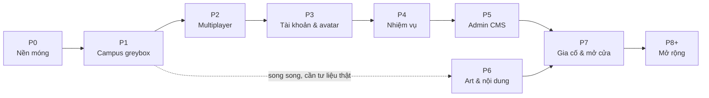

# 10 — Roadmap

## 1. Cách đọc

- Dự án chia thành **phase** (`P0`…`P8`), mỗi phase gồm các **gói việc** có mã (`P1.2`). Mỗi gói việc được cắt vừa cho một đến vài phiên làm việc và luôn kết thúc bằng thứ **chạy được, xem được**.
- Muốn làm tiếp, chỉ cần nói: **"Implement P1.2 theo plan."**
- **Cỡ:** S ≈ 1 phiên làm việc · M ≈ 1–2 phiên · L ≈ 2–4 phiên. Đây là ước lượng thô để so sánh tương đối, không phải cam kết thời gian.
- Cột **Trạng thái** được cập nhật sau mỗi gói việc: `Chưa làm` → `Đang làm` → `Xong`.

## 2. Bức tranh chung

| Mốc | Gồm | Bạn sẽ thấy gì |
|---|---|---|
| **M1 — Đi dạo một mình** | P0 + P1 | Mở link, điều khiển nhân vật đi khắp campus dạng khối, trên cả điện thoại |
| **M2 — Gặp nhau** | P2 | Nhiều người cùng vào, thấy nhau đi lại, vẫy tay, ngồi ghế, chat |
| **M3 — Có danh tính** | P3 | Đăng nhập, tự chỉnh avatar, vào từ máy khác vẫn là mình |
| **M4 — Nhiệm vụ đầu tiên** | P4 | Một nhiệm vụ ngày chơi được từ đầu tới cuối, có điểm, streak, bảng xếp hạng |
| **M5 — Admin tự vận hành** | P5 | Người không biết code tạo và lên lịch nhiệm vụ. **Đây là MVP nội bộ** |
| **M6 — Trông giống campus thật** | P6 | Art, nội thất, nhân vật hoàn chỉnh, thêm loại nhiệm vụ |
| **M7 — Mở cửa** | P7 | Chạy production, đã thử tải, đã pilot |

**Hai điểm dừng để kiểm chứng trước khi đầu tư tiếp:**

1. **Sau M2:** rủ 5–10 đồng nghiệp vào thử 15 phút trên bản greybox. Nếu "cùng có mặt" chưa vui thì chỉnh trải nghiệm giao lưu trước, đừng vội làm nhiệm vụ.
2. **Sau M4:** chạy thử một tuần với nhiệm vụ viết bằng file JSON cho một nhóm nhỏ, rồi mới làm admin. Kết quả tuần thử quyết định loại objective nào đáng làm thêm.

## 3. Định nghĩa "xong" áp dụng cho mọi gói việc

- Chạy được bằng lệnh đã ghi trong README; có cách demo cụ thể.
- TypeScript strict không lỗi; lint sạch; CI xanh.
- Logic phía server có test tự động.
- Không vượt ngân sách hiệu năng/asset ở [03](03-world-and-assets.md) và [04](04-client.md).
- Không có bí mật trong repo.
- Cập nhật cột trạng thái ở file này; ghi chỗ làm khác thiết kế vào `docs/DECISIONS.md`.

---

## P0 — Nền móng

| Mã | Gói việc | Phạm vi | Cỡ | Trạng thái |
|---|---|---|:-:|---|
| P0.1 | Khung monorepo | pnpm workspaces + Turborepo, TypeScript, Biome, Vitest. App rỗng chạy được: `web` (Vite + React + R3F, một khối xoay), `api` (Fastify, `/health`), `realtime` (Colyseus, phòng thử), `admin` (trang trống). Gói `shared`, `map-data`, `core`, `db`. Docker Compose cho Postgres + Redis. `.env.example`. GitHub Actions: lint, typecheck, test, build. README hướng dẫn chạy | M | Xong |

**Nghiệm thu:** `pnpm install && pnpm dev` chạy cả ba app; `pnpm test` và `pnpm build` qua; CI xanh trên nhánh.

---

## P1 — Campus greybox đi lại được (một người)

| Mã | Gói việc | Phạm vi | Cỡ | Trạng thái |
|---|---|---|:-:|---|
| P1.1 | Map-data v0 | Kiểu + zod schema của `CampusMap`. Script nhập `docs/reference/osm-campus.geojson` → `campus.json` v0: khối nhà, đường, sông, hồ bơi, các khu vực và POI giả định (cổng, sảnh, Atrium, canteen, hồ Koi, ghế, điểm xuất hiện, `spawnSet`). Hàm hình học + unit test. `renderFloorSvg()` và một trang debug xem bản đồ 2D từng tầng | M | Xong |
| P1.2 | Dựng thế giới | Bộ dựng thủ tục từ map-data: nền tô màu theo khu, đường, khối nhà có sàn từng tầng + khoảng thông tầng + dốc/cầu thang, mặt nước, cây/ghế/đèn bằng instancing, bảng tên khu. Ánh sáng, bầu trời, sương. Lưới va chạm (BVH) | M | Xong |
| P1.3 | Nhân vật và điều khiển | Nhân vật mẫu có xương (CC0) với đứng/đi/chạy/nhảy. `CharacterMotor` (capsule + BVH). Camera góc nhìn thứ ba chống xuyên tường. Bàn phím + chuột; joystick cảm ứng + kéo xoay + chụm zoom. Máy trạng thái animation | M | Xong |
| P1.4 | Vỏ ứng dụng | Màn hình chào, các bước tải, mức chất lượng + tự điều chỉnh DPR, cài đặt, minimap, thông báo tên khu khi bước vào, lớp phủ debug, sinh avatar giả để đo hiệu năng đám đông | M | Xong |

**Kết quả nghiệm thu P1 (13/11/2026):**

| Tiêu chí | Kết quả |
|---|---|
| Cổng → hồ bơi → Atrium → tầng 2 → tầng 3 không lọt sàn, không kẹt | Đạt — có test tự động chạy motor nhân vật trên lưới va chạm thật (`CharacterMotor.test.ts`), kể cả chạy nhanh và lên/xuống |
| 60 FPS desktop; ≥ 30 FPS Android tầm trung với 50 avatar giả ở mức Medium | **Chưa đo được.** Môi trường phát triển chỉ có render phần mềm. Số đo thay thế: cảnh ~46 draw call / 52.500 tam giác; thêm 50 avatar giả +34 draw call / +4.600 tam giác. Cần thử trên thiết bị thật: mở `/?bots=50&quality=medium&enter`, bấm Debug để xem FPS |
| Đo được thời gian tới lúc đi được và dung lượng tải, nằm trong ngân sách | Đạt — màn hình chào 69 KB gzip; toàn bộ JS trước khi đi được 422 KB gzip (ngân sách 600 KB, kiểm tra tự động bằng `pnpm budget`); dựng xong campus sau ~1,5 s trên máy render phần mềm |
| Chơi được khi cầm điện thoại dọc | Đạt trên trình giả lập Pixel 7 (joystick, xoay camera, nút nhảy); chưa thử máy thật |

**Nghiệm thu:**
- Đi bộ từ cổng → hồ bơi → Atrium → lên tầng 2, tầng 3 mà không lọt sàn, không kẹt.
- Desktop 60 FPS; điện thoại Android tầm trung ≥ 30 FPS với 50 avatar giả ở mức Medium.
- Đo được thời gian tới lúc đi được và dung lượng tải; nằm trong ngân sách.
- Chơi được khi cầm điện thoại dọc.

---

## P2 — Multiplayer

| Mã | Gói việc | Phạm vi | Cỡ | Trạng thái |
|---|---|---|:-:|---|
| P2.1 | Phòng realtime | `CampusRoom` + schema. Token khách tạm cho dev. Vào/ra. Xử lý `move` có kiểm tra tốc độ và biên. Kênh với ngưỡng mềm/cứng + tự xếp kênh. Kết nối lại, một người một phiên. Test phòng bằng `@colyseus/testing` | M | Xong |
| P2.2 | Lớp mạng phía client | `NetClient`, đồng bộ đồng hồ, avatar người khác có nội suy, pool đối tượng, trần LOD, thẻ tên. Lớp phủ kết nối lại. Test e2e hai trình duyệt | M | Xong |
| P2.3 | Giao lưu | Emote + bánh xe emote, ghế, chat gần + bong bóng + rate limit + lọc từ, presence trong Redis, danh sách online, chọn kênh, trạng thái AFK | M | Xong |
| P2.4 | Loadtest | Bot giả lập, endpoint metric, chạy 100 bot/kênh và 500 bot tổng, ghi kết quả vào tài liệu, tinh chỉnh | S | Xong |

**Kết quả nghiệm thu P2 (13/11/2026):**

| Tiêu chí | Kết quả |
|---|---|
| Desktop và mobile thấy nhau chuyển động mượt; e2e tự động xác nhận | Đạt — `tests/e2e/specs/multiplayer.spec.ts` (Chrome desktop + Pixel 7 giả lập), chạy trong CI |
| Rút mạng 5 giây rồi cắm lại: tự vào lại đúng chỗ | Đạt — e2e: người khác thấy "mất kết nối" rồi trở lại bình thường, không phải tải lại trang |
| Mở tab thứ hai cùng tài khoản: tab cũ nhận thông báo | Đạt — e2e |
| Ngưỡng loadtest ở 05 §11 | Đạt — tới 1.000 bot trên một tiến trình, xem bảng kết quả ở 05 §11 |

Ngoài nghiệm thu: emote, ghế, chat gần có lọc từ, danh bạ online và chuyển kênh đều có test server và e2e. Chưa thử trên thiết bị và mạng di động thật.

**Nghiệm thu:**
- Hai trình duyệt (một desktop, một mobile) thấy nhau chuyển động mượt; test e2e tự động xác nhận.
- Rút mạng 5 giây rồi cắm lại: tự vào lại đúng chỗ.
- Mở tab thứ hai cùng tài khoản: tab cũ nhận thông báo đã đăng nhập nơi khác.
- Đạt các ngưỡng loadtest ở [05](05-multiplayer.md#11-kế-hoạch-loadtest), hoặc ghi rõ chênh lệch và hướng xử lý.

---

## P3 — Tài khoản, hồ sơ, avatar

| Mã | Gói việc | Phạm vi | Cỡ | Trạng thái |
|---|---|---|:-:|---|
| P3.1 | DB + API nền + khách | Drizzle schema và migration (users, auth_identities, sessions, settings; `user_stats` chuyển sang P4.1). Khung Fastify: định dạng lỗi, zod, rate limit. Đăng nhập khách, JWT ký bất đối xứng, refresh xoay vòng. `/me`, `/world/bootstrap`. Realtime kiểm tra JWT thật | M | Xong |
| P3.2 | Đăng nhập OIDC | Google + OIDC tổng quát, danh sách domain cho phép, liên kết khách → tài khoản thật, màn hình đồng ý + thông báo quyền riêng tư | S | Xong |
| P3.3 | Avatar module | Các phần rời từ bộ nhân vật CC0, gộp thành một skinned mesh, bảng màu đỉnh, chuỗi cấu hình. Trình chỉnh avatar có xem trước 3D. Lưu và đồng bộ cho người khác. LOD1 + impostor | L | Chưa làm |
| P3.4 | Hồ sơ và lần đầu vào game | Thẻ hồ sơ, phòng ban (script nhập CSV), tuỳ chọn ẩn khỏi danh sách online, luồng lần đầu (tên → avatar → hướng dẫn) | S | Chưa làm |

**Nghiệm thu:**
- Đăng nhập trên điện thoại và laptop ra cùng một người, cùng avatar.
- Khách liên kết tài khoản thật không mất tiến độ.
- Token sai hoặc tài khoản bị khoá không vào được phòng (có test).

---

## P4 — Hệ thống nhiệm vụ

| Mã | Gói việc | Phạm vi | Cỡ | Trạng thái |
|---|---|---|:-:|---|
| P4.1 | Mô hình và engine | Schema dùng chung (mission, objective). Bảng DB (missions, mission_progress, wallet_ledger, user_stats, quiz_questions). `MissionEngine` + handler `visit`, `collect`, `quiz`, `social` kèm unit test. `RewardService` (sổ cái, streak theo ngày làm việc). Lệnh CLI nạp nhiệm vụ từ file JSON | L | Chưa làm |
| P4.2 | Runtime trong phòng | Phát sự kiện game từ các system, `AreaTriggerSystem`, entity dùng chung và riêng, kiểm tra tương tác, các message nhiệm vụ, lưu và khôi phục khi vào lại. Test phòng đầu-cuối | M | Chưa làm |
| P4.3 | Trải nghiệm phía client | Hệ tương tác, hiển thị vật phẩm/kiosk/NPC tạm, biểu ngữ, bảng theo dõi, chỉ đường, hộp thoại quiz, màn chúc mừng | M | Chưa làm |
| P4.4 | Thưởng và bảng xếp hạng | Giao diện điểm/cấp/streak, BXH (Redis + API + UI), lịch sử nhiệm vụ, bộ đếm mục tiêu cộng đồng, worker + job chốt nhiệm vụ | M | Chưa làm |

**Nghiệm thu:**
- Một nhiệm vụ định nghĩa bằng JSON (như ví dụ ở [06](06-missions.md#11-ví-dụ-định-nghĩa-nhiệm-vụ)) chơi được từ đầu tới cuối bởi hai người cùng lúc.
- Thoát giữa chừng rồi vào lại: tiến độ còn nguyên.
- Phần thưởng trao đúng một lần dù gửi lặp (có test).
- Tới giờ kết thúc: nhiệm vụ tự đóng, job chốt chạy, BXH được lưu.

---

## P5 — Admin CMS

| Mã | Gói việc | Phạm vi | Cỡ | Trạng thái |
|---|---|---|:-:|---|
| P5.1 | Vỏ admin + phân quyền | SPA admin, đăng nhập, kiểm tra vai trò ở server (có test), quản lý người dùng, vai trò, án phạt, nhật ký thao tác | M | Chưa làm |
| P5.2 | Trình soạn nhiệm vụ | Danh sách + lịch, form sinh từ schema, bản đồ chọn vị trí, kiểm tra tự động, xuất bản/gỡ/kết thúc/nhân bản, ngân hàng quiz + nhập CSV, xem thử trong game | L | Chưa làm |
| P5.3 | Mẫu, tự điền, vận hành | Kho mẫu, job tự điền ngày trống, thông báo (phát ngay và hẹn giờ), cấu hình + cờ tính năng + công tắc khẩn | M | Chưa làm |
| P5.4 | Kiểm duyệt và số liệu | Nút báo cáo trong game, hàng đợi kiểm duyệt, mute/ban có hiệu lực ngay, đường ống sự kiện analytics, dashboard, trang kết quả nhiệm vụ | M | Chưa làm |

**Nghiệm thu:**
- Một người không biết code tạo trọn nhiệm vụ cho ngày mai trên giao diện, kể cả đặt vị trí trên bản đồ; nhiệm vụ tự bắt đầu đúng giờ.
- Bỏ trống một ngày: hệ thống tự điền từ kho mẫu.
- Cấm chat một tài khoản từ admin: có hiệu lực trong game sau vài giây.
- Dashboard hiện số người online và phễu nhiệm vụ hôm nay.

---

## P6 — Art và nội dung (chạy song song từ sau P1)

| Mã | Gói việc | Phạm vi | Cần từ bạn | Cỡ | Trạng thái |
|---|---|---|---|:-:|---|
| P6.1 | Pipeline asset | Quy ước xuất từ Blender, script gltf-transform, KTX2, manifest, trình tải zone theo khoảng cách, kiểm tra ngân sách trong CI | — | M | Chưa làm |
| P6.2 | Hiệu chỉnh bản đồ | Chỉnh map-data theo sơ đồ và ảnh thật → v1. Công cụ dev đặt POI, xuất JSON | Nhóm A, B ở [03](03-world-and-assets.md#8-tư-liệu-cần-bạn-cung-cấp) | M | Chưa làm |
| P6.3 | Ngoại cảnh | Vỏ nhà và mặt đứng, cảnh quan, hồ bơi, ven sông, cổng, biển hiệu, bầu trời, ánh sáng bake, âm thanh môi trường | Nhóm B, D | L | Chưa làm |
| P6.4 | Nội thất chính | Sảnh, Atrium, canteen, hồ Koi + cà phê, một tầng văn phòng tiêu biểu (bàn ghế và kệ cây sinh theo quy tắc), phòng họp | Nhóm C, E | L | Chưa làm |
| P6.5 | Nhân vật hoàn chỉnh | Nhân vật theo phong cách riêng, tủ đồ, bộ emote, phụ kiện thẻ nhân viên | Góp ý phong cách | L | Chưa làm |
| P6.6 | NPC và navmesh | Bake navmesh, NPC (lễ tân, linh vật), chạm-để-đi, đường chỉ dẫn tới mục tiêu | — | M | Chưa làm |
| P6.7 | Objective mở rộng | `gather`, `emote_at`, `race`, `deliver`, `photo` (kèm chế độ chụp ảnh), `find` + mẫu nhiệm vụ tương ứng; HUD cho nhiều nhiệm vụ chạy song song (tuần, sự kiện) | Kết quả tuần chạy thử | L | Chưa làm |
| P6.8 | Phần thưởng mở rộng | Cửa hàng cosmetic, huy hiệu, BXH phòng ban, ảnh chia sẻ thành tích, ánh sáng theo giờ trong ngày | — | M | Chưa làm |

**Nghiệm thu:** đồng nghiệp nhìn vào nhận ra ngay các điểm mốc; ngân sách hiệu năng vẫn giữ trên điện thoại tham chiếu; mọi zone tải dần được và có greybox dự phòng.

---

## P7 — Gia cố và mở cửa

| Mã | Gói việc | Phạm vi | Cỡ | Trạng thái |
|---|---|---|:-:|---|
| P7.1 | Hạ tầng production | Dockerfile, Compose, Caddy, workflow deploy staging + production, sao lưu, giám sát + cảnh báo, sổ tay vận hành | M | Chưa làm |
| P7.2 | Bảo mật và quyền riêng tư | Rà soát bảo mật, CSP, rate limit, trang chính sách + đồng ý, job xoá dữ liệu quá hạn, luồng xoá tài khoản | M | Chưa làm |
| P7.3 | Tải và thiết bị | Loadtest trên hạ tầng giống production, tinh chỉnh; thử trên ma trận thiết bị kể cả trình duyệt nhúng; Service Worker + PWA | M | Chưa làm |
| P7.4 | Pilot và phát hành | Pilot 20–50 người trong 1–2 tuần với nhiệm vụ hằng ngày, thu góp ý, sửa; danh sách kiểm tra phát hành; mở cửa | M | Chưa làm |

**Nghiệm thu:** hoàn tất danh sách kiểm tra ở [09](09-infra-security.md#72-danh-sách-kiểm-tra-trước-khi-mở-cửa); đã khôi phục thử từ bản sao lưu; pilot không còn lỗi chặn; đã có sự đồng ý về thương hiệu và an ninh nếu mở rộng trong công ty.

---

## P8+ — Sau phát hành (theo thứ tự ưu tiên gợi ý)

| Hạng mục | Ghi chú |
|---|---|
| Thông báo nhắc nhiệm vụ | Web push / email / kênh chat nội bộ |
| Sự kiện trực tiếp ở Atrium | `EventRoom` có chế độ khán giả, sân khấu, chiếu màn hình |
| Voice theo khoảng cách | LiveKit; cần chính sách kiểm duyệt riêng |
| Minigame | Bóng rổ, đua bơi, quiz show; mỗi minigame là một loại phòng riêng |
| Thi đua phòng ban, mùa giải | Dựa trên BXH phòng ban |
| Trang trí theo mùa | Tết, sinh nhật công ty |
| Zalo Mini App | Kênh phân phối + đăng nhập Zalo |
| NPC hướng dẫn viên dùng LLM | Claude API, trả lời câu hỏi về campus |
| Nâng trần kênh lên 300+ | Lọc theo vùng quan tâm, gói chuyển động nhị phân (xem [05](05-multiplayer.md#10-lộ-trình-mở-rộng)) |

---

## 4. Ước lượng tổng

| Phạm vi | Số gói việc | Ước lượng thô |
|---|:-:|---|
| MVP nội bộ (P0–P5) | 21 | Khoảng 25–45 phiên làm việc; nếu quy ra người thì cỡ 10–14 tuần của một lập trình viên full-stack có kinh nghiệm |
| Art và nội dung (P6) | 8 | Phụ thuộc mạnh vào tư liệu và mức độ trau chuốt; P6.3–P6.5 là phần nặng nhất |
| Gia cố và mở cửa (P7) | 4 | Khoảng 4–8 phiên + 1–2 tuần pilot |

Con số sẽ được chỉnh lại sau M1, khi đã biết tốc độ thực tế.

## 5. Ví dụ câu lệnh để gọi implement

- "Implement P0.1 theo plan."
- "Implement P1.1 rồi P1.2. Dùng `docs/reference/osm-campus.geojson` làm dữ liệu nền."
- "Tôi gửi kèm sơ đồ tầng trệt và 12 ảnh ngoại thất. Làm P6.2 cho tầng F1."
- "Implement P4.1, thêm luôn objective `gather` vì tôi cần cho sự kiện thứ Sáu."
