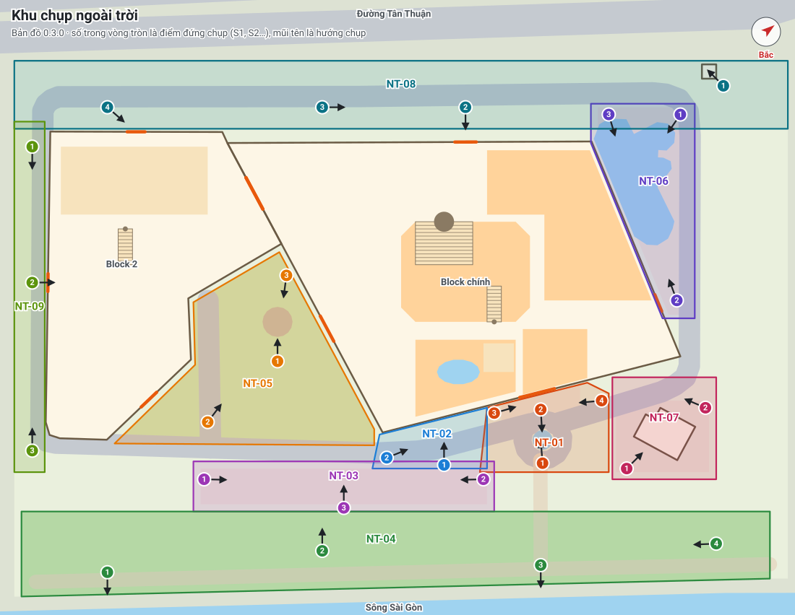
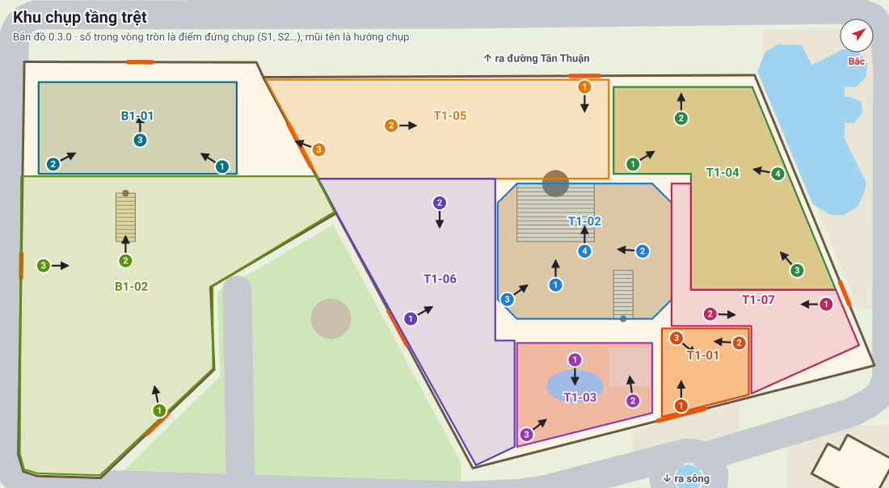
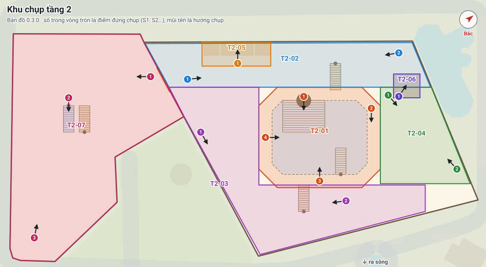
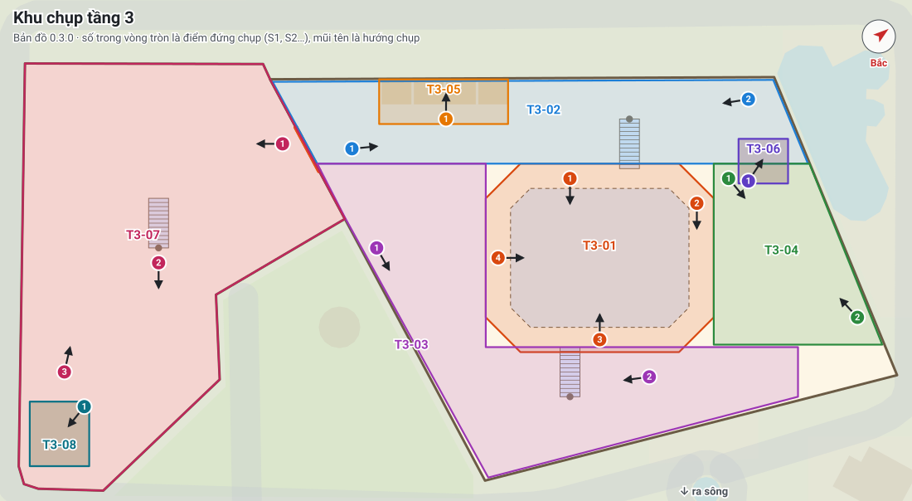

# 12. Khảo sát ảnh thực tế

Để dựng campus giống thật, bạn đi chụp theo từng **khu**, mình ghép ảnh với bản đồ ảo theo **mã khu và điểm đứng** rồi dựng lại khu đó. Danh sách khu, điểm đứng và bản đồ từng tầng ở §3 được sinh từ `packages/map-data/src/survey.ts` bằng `pnpm map:survey`, nên luôn khớp với bản đồ đang có.

Repo đang để công khai: **ảnh không bao giờ được đưa vào repo**. Repo chỉ giữ mã khu, toạ độ, tên file ảnh trong bảng đối chiếu (§4) và những gì dựng lại từ ảnh.

## 1. Cách làm

| Bước | Ai | Việc |
|---|---|---|
| 1 | Bạn | Xin phép, chọn giờ vắng, chụp theo §3 (nhóm "Bắt buộc" trước); mỗi khu một thư mục đặt tên đúng mã khu |
| 2 | Bạn | Nén từng khu (hoặc vài khu) thành zip, gửi vào cuộc trò chuyện. Khu nào xong gửi trước |
| 3 | Mình | Xếp ảnh vào khu và điểm đứng (theo thư mục, tên ảnh, giờ chụp, GPS khi ở ngoài trời), ghi vào bảng đối chiếu §4 |
| 4 | Mình | Dựng lại khu: đường bao, vị trí phòng, cửa, cầu thang trong `tools/map-tools/src/campus-v0.ts`; đồ đạc, vật liệu, màu trong `apps/web/src/game/world/` |
| 5 | Mình | Đặt camera ảo đúng điểm đứng (`/?debug&station=T1-02.S1`, hoặc ô "Điểm chụp" trong bảng Debug), chụp màn hình, đặt cạnh ảnh thật để so; sửa tới khi khớp |
| 6 | Hai bên | Khu khớp thì đổi trạng thái thành "Đã đối chiếu" và bỏ nhãn `placeholder` của các khu tương ứng trên bản đồ |

Thứ tự gợi ý cho buổi đầu (khoảng 2–3 giờ): **SD-01** (sơ đồ thoát hiểm mọi tầng) → NT-01 → T1-01 → T1-02 → T1-03 → T1-04 → B1-01 → T2-01 → T2-05. Sơ đồ thoát hiểm quan trọng nhất: chỉ riêng nó đã cho biết vị trí thật của mọi phòng.

Mang theo: điện thoại sạc đầy (bật định vị để ảnh ngoài trời có toạ độ), sạc dự phòng, thước dây 5 m nếu có. Ngoài trời nên chụp lúc trời sáng đều (sáng sớm hoặc chiều muộn), tránh nắng gắt và ngược sáng.

## 2. Mã khu và điểm đứng

- Mã khu: `SD` sơ đồ và lõi giao thông, `H` tầng hầm, `NT` ngoài trời, `T1` tầng trệt block chính, `B1` tầng trệt block 2, `T2` và `T3` các tầng trên, `M` mái.
- Điểm đứng `S1`, `S2`… là vòng tròn đánh số trên bản đồ, mũi tên là hướng chụp; mã đầy đủ là `T1-02.S1`. Bản đồ hiện tại chưa chính xác, nên đứng gần đúng là được. Chỗ nào thực tế khác hẳn thì chọn chỗ tương đương và ghi một dòng vào `ghi-chu.txt`.
- Mỗi khu có ba nhóm việc ngoài các bước chung: **chụp thêm** (những thứ riêng của khu), **đếm, đo** (để lấy kích thước thật), **cần xác nhận** (chỗ bản đồ đang đoán).

## 3. Danh sách khu

<!-- survey:begin — phần dưới đây tự sinh bởi `pnpm map:survey` từ packages/map-data/src/survey.ts, đừng sửa tay -->

### Mỗi khu đều chụp

1. Từ mỗi điểm đứng (S1, S2…) chụp một ảnh theo hướng mũi tên, rồi thêm một ảnh lệch trái và một ảnh lệch phải. Cầm máy ngang, ngang tầm mắt, dùng ống góc rộng (0.5×) nếu có
2. Một ảnh panorama ở giữa khu (Panorama hoặc Photo Sphere), quay đủ một vòng
3. Mỗi bức tường hoặc mặt đứng: một ảnh chụp thẳng góc, thấy cả chân tường lẫn trần
4. Sàn, trần, đèn: mỗi loại một ảnh cận, thấy rõ vật liệu và kiểu lát
5. Mỗi loại đồ đạc: một ảnh tổng và một ảnh cận, ghi số lượng
6. Thước đo: đếm số viên gạch lát hoặc số bước chân dọc hai cạnh của khu; có thước dây thì đo một hai thứ (bậc, bàn, quầy)
7. Đứng ở cửa hoặc lối đi sang khu bên cạnh, chụp một ảnh nhìn sang khu đó, để ghép các khu lại với nhau
8. Biển tên, biển chỉ dẫn, sơ đồ thoát hiểm nếu gặp

### Quy tắc khi chụp

- Xin phép bộ phận hành chính hoặc an ninh của VNG trước khi chụp
- Chụp lúc vắng người (sáng sớm, cuối giờ chiều); không chụp rõ mặt người
- Không chụp màn hình máy tính, bảng trắng, giấy tờ, thẻ nhân viên, bàn phím mã cửa
- Không vào và không chụp phòng máy chủ, phòng an ninh hay phòng điều khiển, kho, nhà vệ sinh, phòng thay đồ, khu có trẻ em; khu nào cấm thì chỉ ghi chú là có
- Giữ nguyên ảnh gốc, không cắt hay chỉnh: giờ chụp và toạ độ GPS (ngoài trời) trong ảnh giúp đặt ảnh lên bản đồ
- Ảnh gửi riêng cho mình trong cuộc trò chuyện, không đưa lên repo (repo đang để công khai)

### Gửi ảnh

- Mỗi khu một thư mục đặt đúng tên mã khu: `NT-01`, `T1-02`…
- Không bắt buộc đổi tên ảnh; nếu tiện thì thêm điểm đứng vào đầu tên: `S2_…jpg`
- Nén mỗi khu (hoặc vài khu) thành một file zip rồi gửi vào cuộc trò chuyện; khu nào chụp xong gửi trước được
- Gặp thứ không có trong danh sách: chụp, rồi ghi một dòng "ở đâu, cạnh khu nào" vào file `ghi-chu.txt` trong thư mục khu gần nhất
- Quay thêm video đi bộ chậm (1–2 phút mỗi đoạn): cổng → sảnh → Atrium → canteen; Atrium → tầng 2 → sang block 2; một vòng quanh hồ bơi

### Danh sách khu

| Mã | Khu | Ưu tiên | Điểm đứng | Trạng thái |
|---|---|---|---|---|
| SD-01 | Sơ đồ thoát hiểm của từng tầng | Bắt buộc | — | Chưa chụp |
| SD-02 | Thang máy, thang bộ, nhà vệ sinh (mọi tầng) | Nên có | — | Chưa chụp |
| H-01 | Tầng hầm và bãi xe trong nhà (nếu có) | Nếu kịp | — | Chưa chụp |
| NT-01 | Cổng chính, mái che chữ V, đài phun nước | Bắt buộc | 4 | Chưa chụp |
| NT-02 | Mặt đứng phía sông và biển chữ VNG | Nên có | 2 | Chưa chụp |
| NT-03 | Bãi xe dọc đường phía sông | Nếu kịp | 3 | Chưa chụp |
| NT-04 | Công viên ven sông, lối dạo, bờ kè | Nên có | 4 | Chưa chụp |
| NT-05 | Sân vườn giữa hai block | Nên có | 3 | Chưa chụp |
| NT-06 | Hồ bơi và quán The Mojo | Nên có | 3 | Chưa chụp |
| NT-07 | Ki-ốt cà phê ngoài trời và góc đông nam | Nếu kịp | 2 | Chưa chụp |
| NT-08 | Phía đường Tân Thuận: đường nội bộ, cổng xe, chốt bảo vệ | Nếu kịp | 4 | Chưa chụp |
| NT-09 | Phía tây block 2 và hàng rào tây | Nếu kịp | 3 | Chưa chụp |
| T1-01 | Sảnh lễ tân và cổng soát vé | Bắt buộc | 3 | Chưa chụp |
| T1-02 | Atrium và khán đài gỗ | Bắt buộc | 4 | Chưa chụp |
| T1-03 | Khu hồ Koi và quầy cà phê | Bắt buộc | 3 | Chưa chụp |
| T1-04 | Canteen | Bắt buộc | 4 | Chưa chụp |
| T1-05 | Tầng trệt phía bắc: hành lang, cửa bắc, lối sang block 2 | Nên có | 3 | Chưa chụp |
| T1-06 | Tầng trệt phía tây: giữa Atrium và cửa tây | Nên có | 2 | Chưa chụp |
| T1-07 | Tầng trệt phía đông: giữa sảnh, canteen và cửa đông | Nên có | 2 | Chưa chụp |
| T1-08 | Cửa hàng tiện lợi và dịch vụ (7-Eleven, máy bán hàng, ATM) | Nếu kịp | — | Chưa chụp |
| B1-01 | Phòng gym UPFIT | Bắt buộc | 3 | Chưa chụp |
| B1-02 | Block 2 tầng trệt — phần còn lại | Nên có | 3 | Chưa chụp |
| T2-01 | Hành lang quanh Atrium và booth (tầng 2) | Bắt buộc | 4 | Chưa chụp |
| T2-02 | Văn phòng mở block chính — phía bắc (tầng 2) | Nên có | 2 | Chưa chụp |
| T2-03 | Văn phòng mở block chính — phía tây và nam (tầng 2) | Nên có | 2 | Chưa chụp |
| T2-04 | Văn phòng mở block chính — phía đông (tầng 2) | Nên có | 2 | Chưa chụp |
| T2-05 | Phòng họp (tầng 2) | Bắt buộc | 1 | Chưa chụp |
| T2-06 | Pantry (tầng 2) | Nên có | 1 | Chưa chụp |
| T2-07 | Văn phòng block 2 (tầng 2) | Nên có | 3 | Chưa chụp |
| T3-01 | Hành lang quanh Atrium và booth (tầng 3) | Bắt buộc | 4 | Chưa chụp |
| T3-02 | Văn phòng mở block chính — phía bắc (tầng 3) | Nên có | 2 | Chưa chụp |
| T3-03 | Văn phòng mở block chính — phía tây và nam (tầng 3) | Nên có | 2 | Chưa chụp |
| T3-04 | Văn phòng mở block chính — phía đông (tầng 3) | Nên có | 2 | Chưa chụp |
| T3-05 | Phòng họp (tầng 3) | Bắt buộc | 1 | Chưa chụp |
| T3-06 | Pantry (tầng 3) | Nên có | 1 | Chưa chụp |
| T3-07 | Văn phòng block 2 (tầng 3) | Nên có | 3 | Chưa chụp |
| T3-08 | Phòng yoga | Nếu kịp | 1 | Chưa chụp |
| M-01 | Mái và sân thượng (nếu được phép lên) | Nếu kịp | — | Chưa chụp |

### Chung

#### SD-01 · Sơ đồ thoát hiểm của từng tầng

Bắt buộc · Chưa chụp · Sửa trên map: `structure.*`, `area.*`

- **Tìm ở đâu:** Dán ở sảnh thang máy, đầu hành lang, cạnh cầu thang bộ của mỗi tầng. Đây là tư liệu quý nhất: cho biết vị trí thật của mọi phòng
- **Chụp thêm:** Mỗi tầng ít nhất một sơ đồ, chụp thẳng góc, đủ sáng, không loá, đọc được chữ; Nếu sơ đồ chỉ vẽ một phần tầng: chụp hết các bản ở các đầu hành lang; Một ảnh xa hơn cho biết sơ đồ dán ở đâu (để biết chấm "Bạn đang ở đây")
- **Đếm, đo:** Toà nhà có mấy tầng, có tầng hầm, tầng lửng, sân thượng không
- **Cần xác nhận:** Hai khối nhà có thông nhau ở mọi tầng không

#### SD-02 · Thang máy, thang bộ, nhà vệ sinh (mọi tầng)

Nên có · Chưa chụp · Sửa trên map: `connector.*`

- **Tìm ở đâu:** Có ở nhiều nơi: mỗi lần gặp thì chụp và ghi kèm mã khu đang đứng
- **Chụp thêm:** Sảnh thang máy: số cửa, bảng số tầng; Thang bộ: cửa vào và một ảnh nhìn lên chiếu nghỉ; Nhà vệ sinh: chỉ chụp cửa và biển từ bên ngoài
- **Đếm, đo:** Số thang máy ở mỗi sảnh; Số bậc của một vế thang bộ
- **Cần xác nhận:** Các tầng ghi trên bảng thang máy (có B1, M, R không)

#### H-01 · Tầng hầm và bãi xe trong nhà (nếu có)

Nếu kịp · Chưa chụp

- **Tìm ở đâu:** Hỏi bảo vệ lối xuống hầm. Ảnh báo chí có một sảnh tròn, cây lớn ở giữa, cổng soát vé phía sau: có thể nằm ở đây
- **Chụp thêm:** Lối xe xuống hầm, bãi xe máy, bãi ô tô; Sảnh thang máy dưới hầm, sảnh tròn có cây (nếu có)
- **Đếm, đo:** Số tầng hầm
- **Cần xác nhận:** Sảnh tròn có cây ở giữa nằm ở đâu

### Ngoài trời

#### NT-01 · Cổng chính, mái che chữ V, đài phun nước

Bắt buộc · Chưa chụp · Sửa trên map: `area.gate_main`, `area.fountain`, `path.road.roundabout`, `canopy_v`, `door.main.south`

- **Đứng ở:** **S1** Bên kia đài phun nước, nhìn thẳng vào cửa chính, lấy trọn mái che; **S2** Dưới mép mái che, quay lưng vào cửa, nhìn ra đài phun nước; **S3** Góc tây sân trước, nhìn dọc mặt kính về phía đông; **S4** Góc đông sân trước, nhìn dọc mặt kính về phía tây
- **Chụp thêm:** Mái che chữ V: ảnh tổng, ảnh ngước lên thấy kết cấu, ảnh chân cột; Cửa chính: kiểu cửa, số cánh, khung; Đài phun nước: tổng thể và cận mép bồn; Sân trước: gạch lát, bậc, dốc cho xe lăn, bồn cây, đèn
- **Đếm, đo:** Số cột của mái che; bề ngang và chiều sâu mái (bước chân); Đường kính bồn phun nước
- **Cần xác nhận:** Cửa chính có nằm giữa mái che không; Xe đưa đón dừng ở đâu

#### NT-02 · Mặt đứng phía sông và biển chữ VNG

Nên có · Chưa chụp · Sửa trên map: `structure.main`, `logo_sign`

- **Đứng ở:** **S1** Mép bãi xe, nhìn thẳng vào biển chữ VNG; **S2** Góc tây nam, nhìn chéo cả mặt đứng phía sông
- **Chụp thêm:** Mặt đứng: chụp thẳng góc từng đoạn, thấy đủ các tầng và mái; Biển chữ VNG: ở tầng nào, cách góc nhà bao xa; Lam che nắng, cây leo, ban công; Chân tường: bồn cây, cửa thoát hiểm
- **Đếm, đo:** Số ô kính giữa hai cột; Số tầng nhìn thấy
- **Cần xác nhận:** Biển chữ VNG ở tầng mấy

#### NT-03 · Bãi xe dọc đường phía sông

Nếu kịp · Chưa chụp · Sửa trên map: `area.parking`, `car`

- **Đứng ở:** **S1** Đầu tây bãi xe, nhìn dọc hàng xe; **S2** Đầu đông, nhìn ngược lại; **S3** Giữa bãi, quay lưng ra sông, nhìn vào toà nhà
- **Chụp thêm:** Vạch kẻ ô đỗ, bó vỉa, cây bóng mát; Lối người đi từ bãi xe vào cổng; Bãi xe máy nếu có
- **Đếm, đo:** Số ô đỗ ô tô; Bề rộng một ô đỗ (bước chân)
- **Cần xác nhận:** Bãi xe máy nằm ở đâu; Có lối xuống hầm không

#### NT-04 · Công viên ven sông, lối dạo, bờ kè

Nên có · Chưa chụp · Sửa trên map: `area.riverside`, `path.walk.promenade`, `path.walk.river_spur`, `seat.riverside_*`

- **Đứng ở:** **S1** Phía tây lối dạo, nhìn ra sông; **S2** Giữa công viên, quay lưng ra sông, nhìn về toà nhà; **S3** Cuối lối đi từ cổng ra sông, nhìn ra sông; **S4** Đầu đông, nhìn dọc lối dạo về phía tây
- **Chụp thêm:** Lối dạo: mặt lát, bề rộng, đèn, ghế; Bờ kè và lan can ven sông; Hàng cây: loại cây, khoảng cách; Bãi cỏ, chỗ tập thể dục ngoài trời nếu có
- **Đếm, đo:** Số ghế dọc lối dạo; Khoảng cách giữa hai cây (bước chân)
- **Cần xác nhận:** Lối dạo có chạy hết chiều dài khu đất không

#### NT-05 · Sân vườn giữa hai block

Nên có · Chưa chụp · Sửa trên map: `area.forecourt`, `area.garden_planter`, `planter_round`

- **Đứng ở:** **S1** Phía nam bồn cây tròn, nhìn vào bồn; **S2** Góc tây nam sân, nhìn chéo về chỗ hai block giáp nhau; **S3** Chỗ hai block giáp nhau, quay lưng vào nhà, nhìn ra sân
- **Chụp thêm:** Bồn cây tròn: tổng thể, mép bồn, cây giữa; Lối đi uốn cong, mặt lát, bậc thang hay bậc ngồi ngoài trời; Hai mặt đứng nhìn vào sân; Một ảnh từ tầng 2 hoặc 3 nhìn xuống sân (nếu được)
- **Đếm, đo:** Đường kính bồn cây; Số cây lớn
- **Cần xác nhận:** Cửa nào của hai block mở ra sân

#### NT-06 · Hồ bơi và quán The Mojo

Nên có · Chưa chụp · Sửa trên map: `area.pool`, `area.pool_deck`, `seat.pool_*`

- **Đứng ở:** **S1** Góc đông bắc sàn hồ bơi, nhìn chéo cả hồ; **S2** Góc nam, nhìn ngược lên; **S3** Góc tây bắc, nhìn chéo
- **Chụp thêm:** Hồ: hình dạng mép hồ, bậc xuống, màu gạch; Sàn quanh hồ: vật liệu, ghế nằm, dù; Quán The Mojo: quầy, chỗ ngồi; Cửa từ trong nhà ra hồ bơi
- **Đếm, đo:** Chiều dài, chiều rộng hồ (bước chân dọc mép); Số ghế nằm
- **Cần xác nhận:** Ra hồ bơi bằng cửa nào; Phòng thay đồ ở đâu (chỉ ghi chú)

#### NT-07 · Ki-ốt cà phê ngoài trời và góc đông nam

Nếu kịp · Chưa chụp · Sửa trên map: `area.cafe_terrace`, `area.cafe_kiosk`, `seat.cafe_terrace_*`

- **Đứng ở:** **S1** Từ phía sông, nhìn vào ki-ốt; **S2** Góc đông nam, nhìn mặt đứng phía đông nam
- **Chụp thêm:** Ki-ốt: mái, quầy, chỗ ngồi (biển hiệu chỉ để tham khảo; trong game dùng tên chung); Bàn ghế ngoài trời; Lối nối ki-ốt với cổng và với hồ bơi
- **Đếm, đo:** Số bàn ngoài trời
- **Cần xác nhận:** Ki-ốt mở cửa về phía nào

#### NT-08 · Phía đường Tân Thuận: đường nội bộ, cổng xe, chốt bảo vệ

Nếu kịp · Chưa chụp · Sửa trên map: `area.gatehouse`, `path.road.loop`, `door.main.north`, `door.block2.north`

- **Đứng ở:** **S1** Cạnh chốt bảo vệ, nhìn về cổng xe; **S2** Đối diện cửa phía bắc block chính; **S3** Giữa đường nội bộ phía bắc, nhìn về phía đông; **S4** Trước cửa phía bắc block 2
- **Chụp thêm:** Cổng xe ra vào: bề rộng, barie (chụp từ xa); Chốt bảo vệ: chỉ hình khối bên ngoài, không chụp thiết bị an ninh; Mặt đứng phía bắc của hai block, cửa phụ; Dải cây và hàng rào dọc đường Tân Thuận
- **Đếm, đo:** Số làn xe ở cổng; Số cửa trên mặt đứng phía bắc
- **Cần xác nhận:** Có cổng cho người đi bộ phía đường Tân Thuận không; Chốt bảo vệ có ở góc đông bắc không

#### NT-09 · Phía tây block 2 và hàng rào tây

Nếu kịp · Chưa chụp · Sửa trên map: `structure.block2`, `door.block2.west`

- **Đứng ở:** **S1** Góc tây bắc, nhìn dọc mặt tây về phía sông; **S2** Giữa mặt tây, nhìn vào cửa phía tây; **S3** Góc tây nam, nhìn ngược lên
- **Chụp thêm:** Mặt đứng phía tây block 2; Hàng rào và hàng cây ranh giới; Một ảnh khu đất bên ngoài hàng rào
- **Đếm, đo:** Khoảng cách từ tường nhà tới hàng rào (bước chân)
- **Cần xác nhận:** Phía tây có lối ra vào không

### Tầng trệt

#### T1-01 · Sảnh lễ tân và cổng soát vé

Bắt buộc · Chưa chụp · Sửa trên map: `area.lobby`, `speed_gate`, `reception_desk`, `seat.lobby_*`, `npc.reception`

- **Đứng ở:** **S1** Vừa bước qua cửa chính, nhìn thẳng vào trong; **S2** Đầu đông hàng cổng soát vé, nhìn dọc hàng cổng; **S3** Phía trong cổng, quay lại nhìn về quầy lễ tân và cửa
- **Chụp thêm:** Cổng soát vé: cả hàng, rồi cận một cổng (cánh kính, đầu đọc thẻ, đèn); Quầy lễ tân: mặt trước, mặt quầy; Tường chữ, biển chào, màn hình; Ghế chờ, cây
- **Đếm, đo:** Số cổng soát vé, bề rộng một làn; Chiều dài quầy lễ tân
- **Cần xác nhận:** Quầy lễ tân ở giữa, bên trái hay bên phải khi bước vào; Hàng cổng nằm giữa sảnh và Atrium hay ở chỗ khác

#### T1-02 · Atrium và khán đài gỗ

Bắt buộc · Chưa chụp · Sửa trên map: `area.atrium`, `area.atrium_bleachers`, `connector.main.bleachers`, `connector.main.south_1`, `led_wall`, `seat.atrium_*`

- **Đứng ở:** **S1** Trước màn LED, nhìn thẳng lên khán đài; **S2** Phía đông Atrium, nhìn ngang qua khán đài; **S3** Góc tây nam Atrium, nhìn chéo; **S4** Giữa Atrium: một ảnh như mũi tên, rồi một ảnh ngước thẳng lên giếng trời
- **Chụp thêm:** Khán đài: chính diện, nghiêng 45°, cận một bậc có vật làm thước đo (chai nước, ba lô); Lối bậc nhỏ giữa khán đài và lan can hai bên; Màn LED và khối ốp gỗ quanh nó; Từng cây cầu thang bắc ngang Atrium; Giếng trời: chụp ngước thẳng lên; Sàn gỗ, cột, mép sàn các tầng trên nhìn từ dưới lên
- **Đếm, đo:** Số bậc khán đài; chiều cao và chiều sâu một bậc; Bề ngang khán đài (bước chân); Số cầu thang trong Atrium, mỗi cái nối tầng nào với tầng nào
- **Cần xác nhận:** Khán đài quay mặt về màn LED, về sảnh hay hướng khác; Khán đài lên tới hành lang tầng 2 không

#### T1-03 · Khu hồ Koi và quầy cà phê

Bắt buộc · Chưa chụp · Sửa trên map: `area.koi`, `area.koi_pond`, `area.coffee_main`, `coffee_bar`, `back_bar`, `seat.koi_*`, `seat.coffee_*`

- **Đứng ở:** **S1** Mép bắc hồ Koi, nhìn qua hồ; **S2** Trước quầy cà phê, nhìn thẳng vào quầy; **S3** Góc tây nam khu, nhìn chéo về quầy
- **Chụp thêm:** Hồ Koi: hình dạng, mép hồ, đá, cây; Quầy cà phê: mặt quầy, kệ sau quầy, bảng menu; Chỗ ngồi quanh hồ và quanh quầy; Ánh sáng: giếng trời, cửa kính
- **Đếm, đo:** Kích thước hồ (bước chân hai chiều); Số chỗ ngồi
- **Cần xác nhận:** Hồ Koi có ở phía nam Atrium không; Quầy cà phê ở trung tâm campus là quán nào

#### T1-04 · Canteen

Bắt buộc · Chưa chụp · Sửa trên map: `area.canteen`, `canteen_table`, `food_counter`, `slat_ceiling`, `seat.canteen_*`

- **Đứng ở:** **S1** Lối vào canteen, nhìn chéo vào trong; **S2** Trước dãy quầy, nhìn thẳng vào quầy; **S3** Góc đông nam canteen, nhìn chéo cả sảnh; **S4** Phía đông, nhìn về phía tây
- **Chụp thêm:** Dãy quầy phục vụ: tổng thể và từng quầy (bếp Á, bếp Âu, đồ uống…); Bàn ghế: một dãy bàn, rồi cận một bàn với ghế; Trần: khung lam gỗ, đèn, ống kỹ thuật; Khu trả khay, tủ nước, cửa ra ngoài; Cửa kính: nhìn ra thấy gì
- **Đếm, đo:** Số dãy bàn, số bàn mỗi dãy, số ghế mỗi bàn; Chiều dài một bàn; Số quầy phục vụ
- **Cần xác nhận:** Canteen có ở góc đông bắc cạnh hồ bơi không; Canteen có tầng lửng hay chỗ ngồi ngoài trời không

#### T1-05 · Tầng trệt phía bắc: hành lang, cửa bắc, lối sang block 2

Nên có · Chưa chụp · Sửa trên map: `area.main.f1`, `door.main.north`, `door.main.link_f1`

- **Đứng ở:** **S1** Ngay trong cửa phía bắc, nhìn vào; **S2** Giữa khu, nhìn về phía đông; **S3** Trước cửa nối sang block 2
- **Chụp thêm:** Hành lang: bề rộng, sàn, trần; Cửa phía bắc và cửa nối sang block 2; Các phòng hay quầy nằm ở đây (ghi tên trên biển)
- **Đếm, đo:** Bề rộng cửa nối sang block 2
- **Cần xác nhận:** Khu này thực tế là gì (văn phòng, kho, dịch vụ…)

#### T1-06 · Tầng trệt phía tây: giữa Atrium và cửa tây

Nên có · Chưa chụp · Sửa trên map: `area.main.f1`, `door.main.west`

- **Đứng ở:** **S1** Trong cửa phía tây, nhìn về Atrium; **S2** Phía bắc khu, nhìn về phía nam
- **Chụp thêm:** Cửa phía tây và khu ngay trong cửa; Những gì nằm giữa Atrium và mặt tây; Biển chỉ dẫn
- **Cần xác nhận:** Cửa hàng tiện lợi, ATM, máy bán hàng có ở đây không

#### T1-07 · Tầng trệt phía đông: giữa sảnh, canteen và cửa đông

Nên có · Chưa chụp · Sửa trên map: `area.main.f1`, `door.main.east`

- **Đứng ở:** **S1** Trong cửa phía đông, nhìn vào; **S2** Giữa khu, nhìn về cửa phía đông
- **Chụp thêm:** Cửa phía đông; Lối từ sảnh sang canteen và ra hồ bơi; Các quầy hay phòng ở đây
- **Cần xác nhận:** Lối ra hồ bơi và ki-ốt cà phê có đi qua đây không

#### T1-08 · Cửa hàng tiện lợi và dịch vụ (7-Eleven, máy bán hàng, ATM)

Nếu kịp · Chưa chụp

- **Tìm ở đâu:** Chưa biết ở đâu: ghi lại nằm cạnh khu nào, rồi chụp từ lối vào
- **Chụp thêm:** Mặt tiền (biển hiệu chỉ để tham khảo); Bên trong lúc vắng: kệ, quầy thanh toán; Máy bán hàng tự động, ATM, tủ đồ
- **Đếm, đo:** Bề ngang mặt tiền (bước chân)
- **Cần xác nhận:** Nằm ở tầng nào, cạnh khu nào

#### B1-01 · Phòng gym UPFIT

Bắt buộc · Chưa chụp · Sửa trên map: `area.gym`, `gym_rack`, `treadmill`, `rower`, `dumbbell_rack`, `mirror_wall`

- **Đứng ở:** **S1** Góc đông nam phòng gym, nhìn chéo; **S2** Góc tây nam, nhìn chéo ngược lại; **S3** Giữa phòng, nhìn về vách gương
- **Chụp thêm:** Khu tạ tự do: rack, ghế, giá tạ, vách gương; Khu máy chạy, máy chèo, xe đạp; Phòng tập nhóm (yoga, boxing…) và quầy tiếp đón của gym; Sàn cao su, trần, đèn; Không chụp bên trong phòng thay đồ, phòng tắm, sauna
- **Đếm, đo:** Số rack, số máy mỗi loại; Kích thước phòng (bước chân hai chiều)
- **Cần xác nhận:** Gym có ở tầng trệt block 2 không; Phòng yoga ở đâu

#### B1-02 · Block 2 tầng trệt — phần còn lại

Nên có · Chưa chụp · Sửa trên map: `area.block2.f1`, `connector.block2.1`, `door.block2.forecourt`, `door.block2.west`

- **Đứng ở:** **S1** Trong cửa phía sân vườn, nhìn vào; **S2** Chân cầu thang block 2; **S3** Trong cửa phía tây, nhìn sang phía đông
- **Chụp thêm:** Sảnh phụ của block 2; Cầu thang và thang máy của block 2; Các phòng dọc hành lang (ghi tên biển); Khu giữ trẻ nếu có: chỉ chụp lối vào, không chụp trẻ em
- **Cần xác nhận:** Tầng trệt block 2 gồm những khu gì

### Tầng 2

#### T2-01 · Hành lang quanh Atrium và booth (tầng 2)

Bắt buộc · Chưa chụp · Sửa trên map: `structure.main#atrium`, `booth_house`, `seat.booth_f2_*`

- **Đứng ở:** **S1** Đỉnh khán đài, quay lưng vào văn phòng, nhìn xuống Atrium; **S2** Hành lang phía đông, nhìn dọc dãy booth; **S3** Hành lang phía nam, nhìn qua Atrium sang phía bắc; **S4** Hành lang phía tây, nhìn qua Atrium sang phía đông
- **Chụp thêm:** Lan can: kính, tay vịn, chân lan can (ảnh cận); Booth hình ngôi nhà: cả dãy, rồi một booth từ trước mặt và từ bên trong; Nhìn xuống Atrium từ cả bốn phía; Những cây cầu thang bắc ngang Atrium nhìn từ tầng này; Sofa, ghế, cây dọc hành lang
- **Đếm, đo:** Bề rộng hành lang (bước chân); Số booth, bề ngang và chiều sâu một booth
- **Cần xác nhận:** Booth nằm ở hành lang nào, tầng nào; Hành lang có chạy kín một vòng quanh Atrium không

#### T2-02 · Văn phòng mở block chính — phía bắc (tầng 2)

Nên có · Chưa chụp · Sửa trên map: `area.office.f2.main`, `desk_cluster`, `planter_box`

- **Đứng ở:** **S1** Đầu tây khu làm việc, nhìn dọc về phía đông; **S2** Đầu đông, nhìn ngược về phía tây
- **Chụp thêm:** Một hàng bàn: ảnh tổng và ảnh cận bàn, ghế, màn hình, hộp cây cuối hàng; Khu hotdesk, bàn đứng, phone booth, tủ cá nhân, máy in; Cửa sổ: thấy gì bên ngoài; Không chụp màn hình máy tính, bảng trắng, giấy tờ hay người đang ngồi làm việc
- **Đếm, đo:** Số chỗ ngồi của một hàng bàn; Khoảng cách giữa hai hàng bàn (bước chân)
- **Cần xác nhận:** Hàng bàn chạy song song với mặt kính nào

#### T2-03 · Văn phòng mở block chính — phía tây và nam (tầng 2)

Nên có · Chưa chụp · Sửa trên map: `area.office.f2.main`, `desk_cluster`, `plant_shelf`

- **Đứng ở:** **S1** Phía tây bắc khu, nhìn về phía nam; **S2** Phía nam gần mặt kính hướng sông, nhìn về phía tây
- **Chụp thêm:** Một hàng bàn: ảnh tổng và ảnh cận bàn, ghế, màn hình, hộp cây cuối hàng; Góc nghỉ, sofa, kệ cây; Cửa sổ phía sông: thấy gì bên ngoài; Không chụp màn hình máy tính, bảng trắng, giấy tờ hay người đang ngồi làm việc
- **Đếm, đo:** Số hàng bàn trong khu
- **Cần xác nhận:** Khu này là văn phòng mở hay có phòng kín

#### T2-04 · Văn phòng mở block chính — phía đông (tầng 2)

Nên có · Chưa chụp · Sửa trên map: `area.office.f2.main`, `desk_cluster`

- **Đứng ở:** **S1** Góc tây bắc khu, nhìn chéo về phía đông nam; **S2** Góc đông nam, nhìn ngược lại
- **Chụp thêm:** Một hàng bàn: ảnh tổng và ảnh cận bàn, ghế, màn hình, hộp cây cuối hàng; Cửa sổ phía hồ bơi: thấy gì bên ngoài; Không chụp màn hình máy tính, bảng trắng, giấy tờ hay người đang ngồi làm việc
- **Đếm, đo:** Số hàng bàn trong khu
- **Cần xác nhận:** Có lối ra ban công hay sân thượng ở phía này không

#### T2-05 · Phòng họp (tầng 2)

Bắt buộc · Chưa chụp · Sửa trên map: `area.meeting.f2_01…04`, `meeting_room`, `seat.meeting_f2_*`

- **Đứng ở:** **S1** Trước dãy phòng họp, nhìn thẳng vào
- **Chụp thêm:** Mặt ngoài dãy phòng: vách kính, cửa, bảng tên, màn hình đặt phòng; Bên trong một phòng còn trống: bàn, ghế, màn hình, sàn, trần; Phòng họp lớn hoặc phòng đào tạo nếu có; Không chụp nội dung trên màn hình hay bảng trắng
- **Đếm, đo:** Số phòng họp trên tầng và sức chứa ghi trên bảng tên; Kích thước một phòng (bước chân)
- **Cần xác nhận:** Tên của từng phòng họp (ghi lại hết); Phòng họp nằm dọc mặt nào của toà nhà

#### T2-06 · Pantry (tầng 2)

Nên có · Chưa chụp · Sửa trên map: `area.pantry.f2`, `pantry_counter`, `high_table`, `seat.pantry_f2_*`

- **Đứng ở:** **S1** Lối vào pantry, nhìn vào trong
- **Chụp thêm:** Quầy, máy pha cà phê, tủ lạnh, bồn rửa; Chỗ ngồi: sofa, ghế bành, bàn cao; Tường (gạch?), sàn, đèn
- **Đếm, đo:** Số chỗ ngồi
- **Cần xác nhận:** Mỗi tầng có mấy pantry, nằm ở đâu

#### T2-07 · Văn phòng block 2 (tầng 2)

Nên có · Chưa chụp · Sửa trên map: `area.office.f2.block2`, `connector.block2.1`, `connector.block2.2`

- **Đứng ở:** **S1** Vừa qua cửa nối từ block chính, nhìn vào block 2; **S2** Đầu cầu thang block 2, nhìn về phía nam; **S3** Đầu phía nam block 2, nhìn ngược về phía bắc
- **Chụp thêm:** Một hàng bàn: ảnh tổng và ảnh cận bàn, ghế, màn hình, hộp cây cuối hàng; Cầu thang và thang máy của block 2; Các phòng dọc hành lang (ghi tên biển); Không chụp màn hình máy tính, bảng trắng, giấy tờ hay người đang ngồi làm việc
- **Đếm, đo:** Số hàng bàn; Bề rộng hành lang chính (bước chân)
- **Cần xác nhận:** Block 2 tầng này dùng làm gì (văn phòng, phòng họp, đào tạo…)

### Tầng 3

#### T3-01 · Hành lang quanh Atrium và booth (tầng 3)

Bắt buộc · Chưa chụp · Sửa trên map: `structure.main#atrium`, `booth_house`, `seat.booth_f3_*`

- **Đứng ở:** **S1** Mép hành lang phía bắc, nhìn xuống Atrium; **S2** Hành lang phía đông, nhìn dọc dãy booth; **S3** Hành lang phía nam, nhìn qua Atrium sang phía bắc; **S4** Hành lang phía tây, nhìn qua Atrium sang phía đông
- **Chụp thêm:** Lan can: kính, tay vịn, chân lan can (ảnh cận); Booth hình ngôi nhà: cả dãy, rồi một booth từ trước mặt và từ bên trong; Nhìn xuống Atrium từ cả bốn phía; Những cây cầu thang bắc ngang Atrium nhìn từ tầng này; Sofa, ghế, cây dọc hành lang
- **Đếm, đo:** Bề rộng hành lang (bước chân); Số booth, bề ngang và chiều sâu một booth
- **Cần xác nhận:** Booth nằm ở hành lang nào, tầng nào; Hành lang có chạy kín một vòng quanh Atrium không

#### T3-02 · Văn phòng mở block chính — phía bắc (tầng 3)

Nên có · Chưa chụp · Sửa trên map: `area.office.f3.main`, `desk_cluster`, `planter_box`

- **Đứng ở:** **S1** Đầu tây khu làm việc, nhìn dọc về phía đông; **S2** Đầu đông, nhìn ngược về phía tây
- **Chụp thêm:** Một hàng bàn: ảnh tổng và ảnh cận bàn, ghế, màn hình, hộp cây cuối hàng; Khu hotdesk, bàn đứng, phone booth, tủ cá nhân, máy in; Cửa sổ: thấy gì bên ngoài; Không chụp màn hình máy tính, bảng trắng, giấy tờ hay người đang ngồi làm việc
- **Đếm, đo:** Số chỗ ngồi của một hàng bàn; Khoảng cách giữa hai hàng bàn (bước chân)
- **Cần xác nhận:** Hàng bàn chạy song song với mặt kính nào

#### T3-03 · Văn phòng mở block chính — phía tây và nam (tầng 3)

Nên có · Chưa chụp · Sửa trên map: `area.office.f3.main`, `desk_cluster`, `plant_shelf`

- **Đứng ở:** **S1** Phía tây bắc khu, nhìn về phía nam; **S2** Phía nam gần mặt kính hướng sông, nhìn về phía tây
- **Chụp thêm:** Một hàng bàn: ảnh tổng và ảnh cận bàn, ghế, màn hình, hộp cây cuối hàng; Góc nghỉ, sofa, kệ cây; Cửa sổ phía sông: thấy gì bên ngoài; Không chụp màn hình máy tính, bảng trắng, giấy tờ hay người đang ngồi làm việc
- **Đếm, đo:** Số hàng bàn trong khu
- **Cần xác nhận:** Khu này là văn phòng mở hay có phòng kín

#### T3-04 · Văn phòng mở block chính — phía đông (tầng 3)

Nên có · Chưa chụp · Sửa trên map: `area.office.f3.main`, `desk_cluster`

- **Đứng ở:** **S1** Góc tây bắc khu, nhìn chéo về phía đông nam; **S2** Góc đông nam, nhìn ngược lại
- **Chụp thêm:** Một hàng bàn: ảnh tổng và ảnh cận bàn, ghế, màn hình, hộp cây cuối hàng; Cửa sổ phía hồ bơi: thấy gì bên ngoài; Không chụp màn hình máy tính, bảng trắng, giấy tờ hay người đang ngồi làm việc
- **Đếm, đo:** Số hàng bàn trong khu
- **Cần xác nhận:** Có lối ra ban công hay sân thượng ở phía này không

#### T3-05 · Phòng họp (tầng 3)

Bắt buộc · Chưa chụp · Sửa trên map: `area.meeting.f3_01…04`, `meeting_room`, `seat.meeting_f3_*`

- **Đứng ở:** **S1** Trước dãy phòng họp, nhìn thẳng vào
- **Chụp thêm:** Mặt ngoài dãy phòng: vách kính, cửa, bảng tên, màn hình đặt phòng; Bên trong một phòng còn trống: bàn, ghế, màn hình, sàn, trần; Phòng họp lớn hoặc phòng đào tạo nếu có; Không chụp nội dung trên màn hình hay bảng trắng
- **Đếm, đo:** Số phòng họp trên tầng và sức chứa ghi trên bảng tên; Kích thước một phòng (bước chân)
- **Cần xác nhận:** Tên của từng phòng họp (ghi lại hết); Phòng họp nằm dọc mặt nào của toà nhà

#### T3-06 · Pantry (tầng 3)

Nên có · Chưa chụp · Sửa trên map: `area.pantry.f3`, `pantry_counter`, `high_table`, `seat.pantry_f3_*`

- **Đứng ở:** **S1** Lối vào pantry, nhìn vào trong
- **Chụp thêm:** Quầy, máy pha cà phê, tủ lạnh, bồn rửa; Chỗ ngồi: sofa, ghế bành, bàn cao; Tường (gạch?), sàn, đèn
- **Đếm, đo:** Số chỗ ngồi
- **Cần xác nhận:** Mỗi tầng có mấy pantry, nằm ở đâu

#### T3-07 · Văn phòng block 2 (tầng 3)

Nên có · Chưa chụp · Sửa trên map: `area.office.f3.block2`, `connector.block2.1`, `connector.block2.2`

- **Đứng ở:** **S1** Vừa qua cửa nối từ block chính, nhìn vào block 2; **S2** Đầu cầu thang block 2, nhìn về phía nam; **S3** Gần đầu phía nam block 2, nhìn về phía bắc
- **Chụp thêm:** Một hàng bàn: ảnh tổng và ảnh cận bàn, ghế, màn hình, hộp cây cuối hàng; Cầu thang và thang máy của block 2; Các phòng dọc hành lang (ghi tên biển); Không chụp màn hình máy tính, bảng trắng, giấy tờ hay người đang ngồi làm việc
- **Đếm, đo:** Số hàng bàn; Bề rộng hành lang chính (bước chân)
- **Cần xác nhận:** Block 2 tầng này dùng làm gì (văn phòng, phòng họp, đào tạo…)

#### T3-08 · Phòng yoga

Nếu kịp · Chưa chụp · Sửa trên map: `area.yoga`, `yoga_mat`

- **Đứng ở:** **S1** Cửa phòng yoga, nhìn vào trong
- **Chụp thêm:** Sàn, gương, cửa kính và view ra ngoài; Thảm, dụng cụ
- **Đếm, đo:** Kích thước phòng (bước chân)
- **Cần xác nhận:** Phòng yoga ở tầng nào, block nào

### Mái

#### M-01 · Mái và sân thượng (nếu được phép lên)

Nếu kịp · Chưa chụp · Sửa trên map: `structure.main#roof`

- **Tìm ở đâu:** Chỉ khi được phép
- **Chụp thêm:** Giếng trời Atrium nhìn từ trên mái; Vườn trên mái, pin mặt trời; Nhìn xuống sân vườn, hồ bơi, cổng
- **Cần xác nhận:** Mái có sân thượng cho nhân viên không

<!-- survey:end -->

## 4. Bảng đối chiếu ảnh ↔ bản đồ

Điền khi nhận ảnh. Chỉ ghi tên file; ảnh để ngoài repo.

| Khu.Điểm | Ảnh | Đối chiếu với (trên map) | Kết quả |
|---|---|---|---|
| — | — | — | — |
